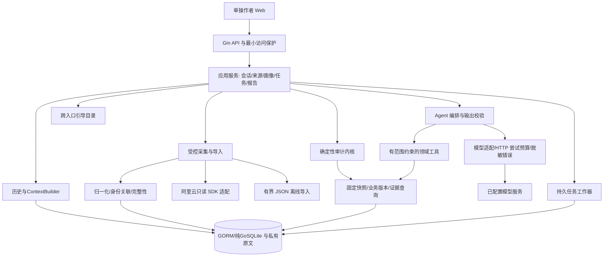
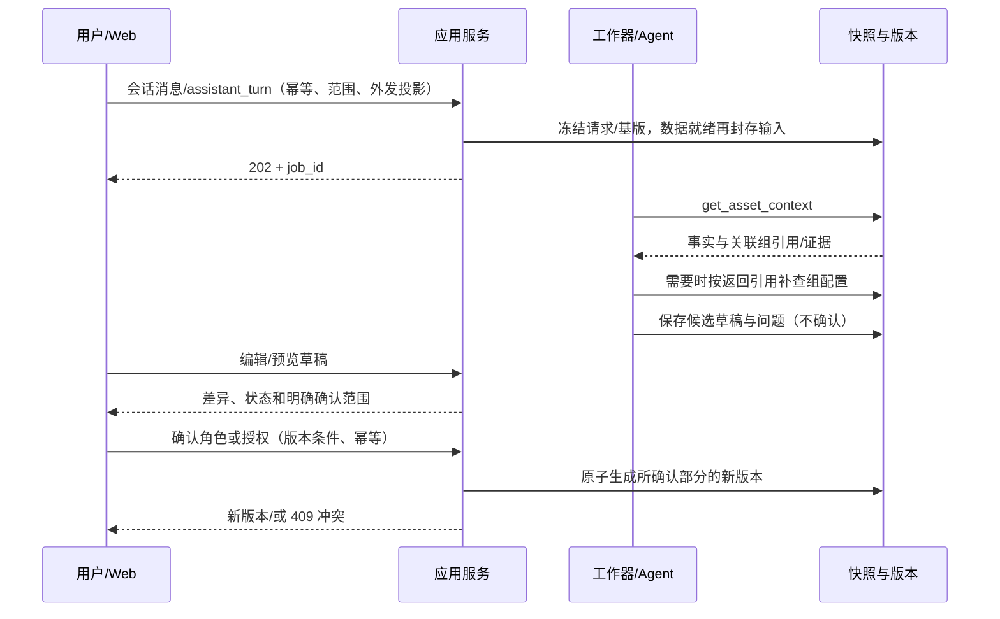

# 系统设计说明书（架构与总体方案）

版本：v0.2。日期：2026-10-22。状态：**P2 设计稿，待用户 G2 审核；正式业务工程未创建**。

设计输入为 [系统需求 v0.5](02-requirements-and-scope.md)、[领域需求 v0.5](12-audit-domain-requirements.md)、[PRD](16-product-requirements-and-user-flows.md) 和 [交叉审核／B0](17-requirements-cross-review-and-design-baseline.md)。本文件取代早期架构讨论；前期候选依据保留在 [技术选型背景](07-technical-background-and-options.md) 与实测记录。B1 补充连续历史、累计时延、统一认证和跨入口引导。细节见 [数据与接口](18-data-and-api-design.md)、[规则与 Agent](19-audit-and-agent-design.md)、[会话／时序](20-session-history-and-data-freshness.md)、[认证](21-credentials-and-tool-auth-design.md)、[推荐引导](22-guidance-and-multi-entry-design.md)。

文中“采用／默认”是设计建议，不是已实现、已运行或用户已逐项指定的事实。没有以设计参数授权新的付费调用、云资源或业务编码。

## 1. 设计目标与明确边界

- 用单个可演示的应用完成数据准备、画像确认、规则／Agent 审计、审阅和复审，而不是搭建通用安全平台。
- 真实采集和离线导入归一化到同一输入；结论保留范围、时点、版本、完整性和证据。
- 规则输出不被模型覆盖；Agent 具备实际工具选择与依赖补查空间，但权限、数据和预算由后端控制。
- 只读云接口；确认／待办只改本地业务资料，不修改标签、安全组、CFW 或产品开关。
- 不接云安全中心、不安装客户端、不主动扫描；不做多云、多 Agent、完整拓扑、自动修复、RAG／向量库和微服务。
- B0 默认 M0 的 CHK-01～08；IPS／日志精确检查 M1 默认关闭。WAF 等只有条件性核查建议，不成为新的 API 或采购依赖。

设计案例规模为 3～10 个资产、约 200 条策略；这是工作量假设，不是实测容量。硬限制、降级和将来测试条件另列，不承诺企业高并发或指定时限的业务收益。

## 2. 技术取舍与 ADR 摘要

一手资料编号见 [参考索引](06-references.md)。已有实验与新设计依赖的验证程度必须分开。

| 决策 | 设计建议 | 选择理由与替代方案 | 当前证据／待验收 |
| --- | --- | --- | --- |
| ADR-01 后端 | Go＋Gin，底层 net/http.Server／Transport；类型化应用服务 | Gin 负责路由、JSON、访问／恢复／日志中间件，不代替云 SDK 或 Agent；领域不依赖 Gin Context | D-01／07 已核读，Gin 未项目构建；显式 loopback，不照抄默认监听 |
| ADR-02 Agent | 复用 Eino ADK 与固定模型组件，自研领域工具、规则、证据和权限 | 已有集成与受限 MiniMax 证据；不自研通用 Agent 框架，不因此把业务外包给框架 | 起点为 Eino v0.9.22／组件 v0.1.13；正式服务整合、连续依赖补查未验收 |
| ADR-03 前端 | Vue 3＋TypeScript＋Vite，少量组件与浏览器 `fetch` | 表单、表格、确认卡为主；独立工程便于迭代，首版不引入状态平台或聊天框架 | 官方路线已核读 D-02／03；未安装依赖或正式构建，版本与锁文件在 G2 后冻结 |
| ADR-04 持久化 | SQLite 必须纯 Go；建议 GORM＋社区 libtnb/sqlite／modernc，原文另存 | ORM 管业务记录／事务／历史，不替代版本／幂等约束；不采用默认 CGO 示例 | D-04／05／08～10；未安装构建。须 CGO_ENABLED=0 验收；不满足则退回直接 modernc，不放松纯 Go |
| ADR-05 执行 | 同进程持久阶段／任务表＋一个工作器，事件轮询 | 缓存优先，前台优先；可选定时采集默认关，不自动调模型，不等待本队列中的子任务 | 统一根时限含排队／认证／采集／模型，见 20；未实测 |
| ADR-06 模型 | 保留用户当前 MiniMax 配置，首版仅非流式 Chat Completions | 复用现有最小兼容证据；不替换私有模型，不同时扩 Responses／流式 | 两个人工样例只测一批工具；原生 JSON Schema 不作兼容承诺 |
| ADR-07 部署 | 源码前后端分离；生产静态产物可由同一 Go 服务同源提供 | 分离开发不必分离部署，减少跨域、端口和服务维护 | 默认 loopback＋最小访问口令；外部部署须另审 TLS／认证，不是公网生产方案 |
| ADR-08 历史／Eino | 持久会话／公开消息／上下文摘要，关联有界执行；不持久完整 checkpoint | 历史不等执行恢复，原始 reasoning 不落库；重启能续聊但不重放请求 | F-08／09 及缓存 v0.9.22 Runner 已核读，正式历史／恢复未实现 |
| ADR-09 引导 | 共用 GuidanceCatalog，Web／CLI／TUI 各自呈现 | 空态、续聊、解释／复审均有下一步，建议不隐式执行 | 见 22；Web 首入口，终端交付必须同等语义，不冒称已有命令 |

当前 `.env.example` 和脚本只覆盖已有实验；本设计中的访问保护、任务、数据库和 Web 参数尚未实现，不要求用户现在填写新字段，也不存在正式系统安装／启动命令。

## 3. 逻辑视图：职责与信任边界



| 组件 | 负责 | 禁止／不负责 |
| --- | --- | --- |
| Web／未来终端 | 五视图／对应入口、连续会话、上下文推荐与分层输出 | 不持有云／模型密钥，不判定策略事实，不直接访问厂商 API |
| Gin HTTP 层 | 路由、访问保护、结构／版本校验；异步任务不依赖已结束的请求 context | 不在 handler 长事务内等待模型，不暴露通用 SDK 方法 |
| 应用服务 | 用例编排与版本、权限和事务边界 | 不将候选直接写为授权，不自动下发 |
| 采集／归一化 | 白名单只读查询、分页、引用、身份关联、原始与规范化映射 | 不把权限错误或漏页当空数据，不丢弃高级条件后硬算 |
| 规则内核 | 已支持子域的确定性事实／差异与范围证据 | 不证明运行时监听、端到端可达或厂商规则已下发 |
| Agent／工具 | 根据疑点选读受控证据、补查并形成条件建议 | 不任意查询 SQL／文件／URL，不改规则、权限、业务确认或预算 |
| 报告／审阅 | 保存原始发现、本地处理计划、公开投影和复审关联 | 待办不等于修复，报告不导出凭据、原始模型消息或私有端点 |

Agent 默认读快照和固定业务版本，而非任意实时调用云接口。缺口先形成可审阅状态；需要新云数据时由用户新建受控采集及审计，不在工具循环中扩账号、地域或数据范围。

## 4. 开发视图：拟议工程与依赖方向

以下是 **G2 后的目标结构，不是已存在工程或可运行命令**。

```text
server/
  cmd/server/                 组装与启动
  internal/httpapi/           Gin DTO、访问保护、错误、幂等
  internal/app/               会话、数据计划、用例与事务边界
  internal/domain/            资产/画像/规则结果/证据/任务契约
  internal/audit/             三值匹配、集合比较、检查器
  internal/agent/             Eino 编排、工具授权、输出校验
  internal/adapters/aliyun/    CFW、ECS 与必要关联
  internal/adapters/model/     已配置 Chat Completions、HTTP guard
  internal/storage/           GORM／纯GoSQLite 仓储与私有文件
web/                          Vue/TS/Vite、五视图与通用 API 客户端
testdata/public/              公开构造输入、标签与期望；不含真实云数据
data/private/                 数据库、原文、私有配置；现有 Git 忽略范围
runtime/                      本地诊断／临时文件；现有忽略范围
```

依赖为入口／适配器向应用与领域收敛。领域类型与规则不依赖 Eino、HTTP、SQL 或厂商 SDK；工具复用应用查询，不复制审计逻辑。云 DTO 与 Web DTO 分开，原始 SDK 类型不直接成为公共接口。实验保留独立 module，不直接当正式服务或整包迁移。

工程初始化时再补前端依赖／产物忽略规则、锁文件和版本检查；本轮不创建脚手架、数据库迁移或业务目录。

## 5. 进程视图：任务与状态

### 5.1 连续业务会话与执行任务分开

默认空间保存来源／资料和多个会话，消息、确认、执行、规则与报告均可查；刷新／重启后继续原会话，不每轮从零开始。应用持久历史与 ContextBuilder，Eino 负责当前有界执行；完整 checkpoint／reasoning 不直接存库。

任务 kind：collect、assistant_turn（画像引导／审计追问）、audit、connection_check，均关联会话／触发意图。导出、引导目录和确认预览为本地有界操作，不额外调模型。

pinned_snapshot／prefer_fresh／force_refresh 控制数据来源。需刷新时纳入本次 audit 阶段，不同步等待自己队列中的子任务；可选定时只采集快照，默认关闭。请求／范围／资料基版先冻结，数据就绪、规则开始前封存 resolved_input_manifest，之后不得偷偷切换最新快照。见 20。

### 5.2 执行语义

`queued → running → completed / partial / failed / cancelled`；取消请求先置 `cancelling`，工作器协作终止。重启后遗留 `running/cancelling` 标 `interrupted`，不自动重放付费请求；未启动的 `queued` 可继续，须先确认输入仍存在且预算可用。

初版一次运行一个长任务，队列最多 10 个，用户优先、后台默认关闭；事务只写状态／证据，不跨网络等待。实际请求预先计尝试、失败也占次数，SDK 重试不获得额外额度。取消只能停止后续尝试并尽力中断当前请求，不能保证供应商未执行或撤回费用。

`completed` 表示流程结束，不表示所有检查通过。缺少业务信息可正常产出待确认；采集／解析覆盖受损、模型失败或资源限额导致未完成阶段时为 `partial`。检查结论、覆盖与任务状态分别展示。

消息／轮次／新任务原子绑定幂等意图；同键同内容返回同任务，同键异内容冲突。画像／授权更新用基版本与确认预览，不因双击生成多个版本。详细状态和响应见数据与接口设计。

### 5.3 累计时间与分层反馈

根时限覆盖排队、认证、采集、规则和模型链，不能只算单次模型 timeout。audit 的排队／执行／总计 120／240／360 秒，执行内采集 90、规则 20、模型 120、最终化 10 秒为待 G2 上限提案，不是已测响应或付费授权，用户更严格配置优先。

输出分 L0 计划／队列、L1 带时点事实、L2 已落地规则、L3 Agent 校验后补充、L4 汇总报告；不等模型结束才显示规则。墙钟与请求累计耗时分开，不编进度百分比。完整策略见 20。

## 6. 物理视图：部署、数据与访问保护

默认单机：浏览器 → 同源静态 Web／Go API → 本地 SQLite／私有文件；后端单向访问获准的阿里云与模型端点。开发可用 Vite 同源代理；后端默认 `127.0.0.1`，不因前后端分离自动开放 CORS 或 `0.0.0.0`。

本地敏感／付费 API 也要求最小访问口令：操作者运行时输入应用口令，浏览器仅内存保存并在同源请求头传递；不放 URL、bundle、localStorage 或日志。服务端口令放私有配置并常量时间比较；它不是云／模型密钥，不引入用户组织表。具体配置键和解锁界面在 G2 后实现，不扩成身份平台。

校验 Host／Origin 与方法；默认无跨域授权。API 不提供公开原文／数据目录，下载也通过受保护请求取得后本地保存，不能把口令拼在下载链接。非 loopback 部署必须明确 TLS、可信代理与认证方案后重新审核，不能直接按本方案暴露公网。

GORM 经纯 Go SQLite 驱动连接本地盘，短事务、单连接，暂不用 WAL；不放 NFS／共享盘。不在事务中调用工具／云／模型；ORM 不自动解决并发。false／空集合显式写，条件更新校验影响行数，不用 Save／启动 AutoMigrate 绕过历史不变性。私有目录按平台最小权限设置，数据库和原始快照位于既有忽略路径。备份须保持数据库与原文引用一致，不将备份或凭据推 Git。

统一认证见 21：应用口令、云 RAM／STS、模型 key 和工具授权分层；CFW／ECS 共用明确 CloudCredentialProvider，不把 AK 交给 Agent。启动检查仅本地，不隐式读全局 profile／换取 STS；MCP 不是必需，也不替代云身份。

## 7. 数据隐私与输出安全

1. 云凭据／模型密钥只在服务端凭据链／私有配置；DB 存引用和配置版本，不在 API 回显值。SDK 错误转稳定类别，不持久化原始请求头或服务响应。
2. 真实模型任务绑定获准字段投影，默认资产别名、允许的标签键和最小证据；原始快照／任意标签不直接发送。用户确认一次任务范围，不逐个请求弹确认；不得后台扩大范围或预算。
3. 外部名称、描述、标签和日志一律数据。工具仅从已绑定快照／身份关系读对象，无写入、通用 RPC、任意 SQL、shell 或 URL 工具。
4. 保留协议所需的 assistant 信息仅在运行内存；不把完整模型消息、reasoning 或原始 Eino 事件直接存日志。持久化项目定义的工具事件／公共摘要。
5. 前端按文本展示外部内容，禁用不可信 HTML／脚本；正式生产 CSP／同源设置与离线原型无关。Markdown 导出是文本，不增加任意 HTML 渲染入口。
6. 默认公开导出采用字段白名单与报告内别名，只保留受控结构、模板解释和证据编号；原始模型／用户自由文本默认不导出，不能宣称自动脱敏能识别一切秘密。内部页面可看授权范围的原数据，不生成公开分享链接。
7. 输出校验能检查 schema、对象、来源、条件和引用，不保证所有自然语言都正确；模型疑点始终与原始规则发现分开。

## 8. +1 场景视图

### 8.1 自动线索与确认



### 8.2 审计、失败与复审

规则先保存，Agent 失败保留规则结果并标部分完成；缺白名单可产生基线发现与业务待确认并存。用户从结果补资料后生成新版本，新建关联审计；旧任务和报告不改写。采纳为本地待办只附加审阅记录，不转成云变更或风险修复。队列／数据库中断、取消、越界工具和模型无效输出均须有明确反馈。

## 9. 验收追溯与后续实施顺序

| 需求 | 主要设计位置 | 对应验证 |
| --- | --- | --- |
| FR-01～03 | 来源、采集／导入、快照完整性与对象 API | AC-01／02／03；页断／未知引用／关联失败 |
| FR-04／12 | 草稿、确认预览、画像与授权独立版本 | AC-04／11／14；RC-11～14／17 |
| FR-05 | 确定性内核与 CHK-01～08 | AC-05；DC-01～09、RC-01／16、算法边界矩阵 |
| FR-06／07 | Eino、领域工具、预算和输出校验 | AC-06／07；依赖式工具链、无证据输出、失败 |
| FR-08 | 持久任务、幂等、取消／中断 | AC-07；RC-18／19，重启不重放 |
| FR-09／13／15 | 五视图、分层条件建议、本地审阅 | AC-09／12／14；待办不等于修复 |
| FR-10／11 | 版本化报告、公开投影与比较 | AC-08／10；对象缺失不等于消失 |
| FR-14（M1） | 可选日志摘要／状态接口，B0 关闭 | 若未来启用再做 AC-13，不装空壳假称已支持 |
| FR-16 | 持久会话／可见消息、ContextBuilder、会话关联执行 | AC-15；RC-21／22，重开历史不重放 |
| FR-17 | 数据策略、配置族原时点与实际输入晚封存 | AC-16；RC-23，缓存／强制刷新／陈旧回退 |
| FR-18 | 根／阶段时限、事件和 L0～L4 | AC-17；RC-24，HTTP 与 job context 分离 |
| FR-19 | CloudCredentialProvider、显式来源／账号与专用工具范围 | AC-18；RC-25，STS／身份／启动检查 |
| FR-20 | GuidanceCatalog 与 Web／CLI／TUI 适配规范 | AC-20；RC-27～31，不隐式执行 |
| NFR-01～09 | 访问／投影、持久记录、纯 Go、累计预算、版本／证据 | AC-19；RC-17～31，实际驱动／认证／时序后续验证 |

G2 后建议先建立数据契约与规则案例，再做采集／导入、画像与任务、规则、Agent、Web 审阅和复审。新增依赖先做离线构建与集成；真正的多轮依赖工具实测和云端只读验收按范围／预算另安排。不得直接据本文运行尚不存在的正式命令。

## 10. G2 待审与已知限制

G2 重点核对 Gin、GORM／纯 Go 适配、持久会话、数据策略／累计预算、统一凭据与跨入口引导。B1 继承 B0 只读／成本范围，不把新增历史与框架能力误当已验证。它们已经给出推荐而非继续列无穷候选，但尚未获得 G2 批准。

尚未验证：正式前后端构建、SQLite 驱动与迁移／故障恢复、真实云权限与字段、真实模型连续依赖补查、性能／并发与审计效果。现有 MiniMax 结果仅是两个小样例；本设计不据此声明生产可用、完整合规或效果优于基线。

本轮增量 Review 见 [记录](23-design-v02-review-and-publication.md)。社区纯 Go 适配须固定版本并通过 CGO_ENABLED=0 验证；不为 ORM 便利退回 CGO，也未据此安装依赖或运行新服务。
