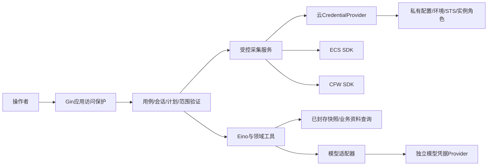

# 专用工具、外部凭据与认证授权设计

版本：v0.1。日期：2026-10-22。对应需求 v0.5／设计 v0.2，**待 G2；新配置字段和连接能力尚未实现**。

关联：[系统设计](03-architecture-discussion.md)、[数据／API](18-data-and-api-design.md)、[会话与时序](20-session-history-and-data-freshness.md)。本项目是专用审计应用，不是能连接任意工具／账号的通用 Agent；默认直接通过官方 SDK，不要求外部 MCP。

## 1. 四种身份不能混为一个 token

| 层 | 证明／允许什么 | 配置位置与边界 |
| --- | --- | --- |
| 应用访问 | 操作者是否能读本地历史、建任务、确认资料和导出 | 最小本地访问口令／同源控制；不是云密钥，不形成组织账号系统 |
| 云连接身份 | 该连接以哪个 RAM 用户／角色调用哪些云服务 | 服务端 CredentialProvider；CFW 与 ECS 可共享一个明确的凭据来源，但各自权限均需具备 |
| 模型身份 | 已配置模型服务的 API 访问 | 独立 ModelCredentialProvider，继续使用私有 CFW_MODEL 配置，不借用云 AccessKey |
| 工具执行授权 | 此次会话／任务允许读哪些资产、引用、数据字段、调用多少次 | 服务端专用 ToolRegistry＋范围／预算；模型不接收凭据，也不能提升权限 |

MCP 若未来出现，是第五个“连接到工具服务器”的认证边界，不替代云身份、应用身份或工具权限。

## 2. 依赖注入：凭据不经模型传递

启动时组装接口：采集服务持有 CloudClientFactory／CredentialProvider，模型适配器持有 ModelCredentialProvider，Agent 工具仅持有领域 QueryService 与授权上下文。云 SDK、私有配置和 raw token 不作为工具参数，也不放聊天／系统提示词／可序列化 Eino state。

Gin 的 request context 仅用于本次 API 的认证、验证和短事务。异步任务复制已验证的 operator／workspace／connection／scope 引用和预算，由服务根 context＋任务 deadline 驱动；不得保留池化 Gin Context，也不能因返回 202 就把后台工作取消。

## 3. 云平台与云防火墙的统一连接

同一 `cloud_connection_id` 描述：账号期望值、允许地域／资产／API、凭据来源模式、配置版本及脱敏就绪状态。ECS、CFW、必要 VPC 客户端注入同一凭据 Provider，再由各 SDK 为相应服务签名；不要求每个产品在对话里分别输入 AK。

但共享身份不等于共享全部权限：RAM 需要覆盖各产品相应读取动作，应用还要限制该任务真正需要的操作和对象。身份验证成功不代表账号开通了 CFW，也不代表 API 分页／字段／保护范围完整。

### 3.1 最小业务动作映射

以下动作名依据已保存官方资料的授权段落；不是已经下发的 RAM 策略，不自动创建 RAM 用户／角色或授权。资源级限制与条件是否支持以各接口授权页为准，不能从 SDK 包名猜 RAM namespace。

| 数据 | 只读业务 API | 官方动作／处理 |
| --- | --- | --- |
| CFW 资产 | DescribeAssetList | `yundun-cloudfirewall:DescribeAssetList` |
| CFW 互联网 ACL | DescribeControlPolicy | `yundun-cloudfirewall:DescribeControlPolicy` |
| 静态引用 | DescribeAddressBook | `yundun-cloudfirewall:DescribeAddressBook` |
| ECS 上下文 | DescribeInstances | `ecs:DescribeInstances` |
| 安全组上下文 | DescribeSecurityGroupAttribute | `ecs:DescribeSecurityGroupAttribute` |
| 必要网卡／EIP | 相应 Describe 查询 | 仅范围确需时添加并按 A-27／A-13 核对授权，不默认整个 VPC 读权限 |
| 当前调用身份 | GetCallerIdentity | 仅明确的连接检查／首次受控采集时核对账号与身份；A-30 暂无授权信息透出，不编造其最小 IAM 条文 |

某些列表查询为完整性需要读取账号相关策略分区；必须在采集前展示这一读取范围。RAM 资源粒度不足时，应用范围和模型投影仍限制用途，但不能反称 RAM 已实现每台资产级隔离。

## 4. CredentialProvider 模式与启动注入

A-28／A-29 提供官方 Go 凭据路线。**本应用默认显式选择连接模式，不无条件采用整台机器的默认凭据链**，不悄悄读 `~/.aliyun`、其他项目或公司环境身份后尝试调用。

| 模式 | 场景 | 自动续期／前提 |
| --- | --- | --- |
| `env_sts`／私有临时配置 | 本地开发时由操作者注入 STS 三元组 | 单次静态三元组不能自己续期；过期需重新注入或改用有可续期来源的模式 |
| `env_ak`／私有 RAM AK | 暂不具备短期凭据条件的本地演示 | 只允许明确的低权限 RAM 身份，不支持主账号 AK；保护与轮换由操作者负责 |
| `assume_role` | 已配置低权限源身份及目标 RAM 角色 | 由角色 Provider 取得／续期 STS；源身份和 sts:AssumeRole 授权必须实际具备，系统不自动提权 |
| `ecs_ram_role` | 应用后来部署到已绑定角色的 ECS | 使用实例角色 Provider，不把长期 AK 写镜像；只有显式启用此模式才访问相应凭据来源 |

默认链是 SDK 提供的能力，不是本应用自动获准使用的身份。若以后允许标准环境变量／配置 profile，也需操作者显式选定并绑定期望账号，不能凭缺少项目配置就回退到其他身份。

客户端按连接／配置版本复用，避免每个工具或接口重新创建 Provider、重复换取 STS；并发续期合并。密钥／token 轮换不应破坏业务历史；新密钥仍需属于相同允许身份，账号／权限边界改变则重新校验并阻止越界任务。

## 5. 配置契约与实际可用性

### 5.1 配置来源

- 本地可从进程环境／启动注入与忽略的 `.env.local` 解析，进程显式值优先，空值不偷偷回退。部署环境可用安全注入而非写入代码。
- 多字段组成的云凭据必须来自同一明确配置记录，不能把环境中的 AK ID 与文件里的其他账号 secret 拼在一起；配置模式／版本先解析，再原子构造 Provider。
- GORM 仅保存 `credential_ref`、模式、期望身份绑定、配置版本、检查时间与脱敏状态；不保存 raw AK、secret、STS／OAuth token，也不把它们写进会话或报告。
- 云凭据不放 `VITE_` 变量、前端 bundle、URL、截图或日志。MCP 子进程将来若有，也不能继承整份应用环境。

### 5.2 未来字段示意，不是当前运行配置

现有 `.env.example`／实验只实现模型字段。下面是正式服务未来的设计字段，**本轮未实现读取，不要求用户现在填写，不因存在示意就能调用云服务**。

| 计划字段 | 用途 |
| --- | --- |
| `CFW_APP_ACCESS_TOKEN` | 本地应用入口保护，和云／模型凭据分开 |
| `CFW_CLOUD_CONNECTIONS_FILE` | 私有连接元数据／凭据引用与范围，不是可分享文件 |
| `CFW_ALIYUN_CREDENTIAL_MODE` | 明确选择上述模式，不自动读全局链 |
| `CFW_ALIYUN_ACCESS_KEY_ID`／`CFW_ALIYUN_ACCESS_KEY_SECRET` | 明确连接的 RAM AK 或临时凭据字段，均不得回显 |
| `CFW_ALIYUN_SECURITY_TOKEN` | 仅 STS 模式需要；不能和长期 AK 混用 |
| `CFW_ALIYUN_EXPECTED_ACCOUNT_ID` | 防止误连其他账号，保留在私有连接信息 |
| 角色引用／实例角色配置 | 由对应模式配置，不要求所有模式填写全部字段 |
| 已有 `CFW_MODEL_*` | 保留当前 MiniMax 配置与更严格调用上限，不替换模型 |

### 5.3 三阶段检查

1. **启动／config-check**：纯本地检查模式、字段完整性、引用、范围与是否配置；不获取 STS、不查身份、不启动采集／模型。配置有效不等于认证成功。
2. **显式连接检查或受控采集的 auth 阶段**：解析凭据，必要时续期，核对调用身份与期望账号。错误／账号不匹配立即停止，不退到别的 profile。
正常应用启动后的调度与纯配置检查分开：只有操作者以前明确启用的策略才在运行期按下一到期时间排采集；config-check 模式不启动工作器／调度。初始化本身不触发身份／模型请求，也不补执行错过周期。

3. **具体产品读取**：按白名单调用，分别报告权限不足、产品未就绪、分页／范围和实际字段能力。不能把构造 SDK 成功当产品可用。

状态分别为 `configuration_valid`、`identity_verified`、`credential_expiry_known`、`refreshable`、`product_ready` 和 `last_checked_at`；前端只取脱敏状态及连接别名。未通过检查时仍可查本地历史、做离线导入／人工画像，不删除以前数据。

## 6. 续期、时延与错误

静态 STS 过期时不能声称 SDK 总会自动续期；只有角色等 Provider 有明确可续期来源才成立。取得凭据、身份检查、刷新、API 请求和退避均计入采集阶段和根预算，不能只统计 Describe 接口网络耗时。

凭据库的缓存、刷新触发、内部超时／重试及 transport 注入要在固定版本中验证。给 GetCredential 外套一个协程超时并不证明底层调用停止；已发出的请求只能尽力中止，不保证撤回。默认不增加独立无限后台续期任务，单次过期只允许受控刷新／重试，不重建整个审计来消耗新额度。

| 类别 | 行为 |
| --- | --- |
| 配置缺失／类型混搭 | 本地返回配置错误，不发外部请求，不要求在聊天贴密钥 |
| 静态 STS 到期 | 说明需操作者更新连接；原历史保留，不自动回长期 AK |
| 可续期角色凭据到期 | 在既定次数／剩余时限内请求 Provider 刷新，失败停止该阶段 |
| AssumeRole／API 被拒绝 | 返回权限类别与受影响阶段，不自动加权限或尝试全局身份 |
| 账号不符／主账号身份 | 拒绝继续业务采集，显示连接别名／错误类别，不在公开记录输出对方账号详情 |
| 限流／服务失败 | 共享限速、有限退避；记录真实尝试和累计时间，不多层重试叠加 |

应用默认接受被明确配置的 RAM 用户／AssumedRole 业务身份；上游角色源也应是低权限 RAM 身份，不能仅以最终角色身份验证就证明上游 AK 没有过高权限。系统不自动创建这些身份，操作者在实际接入时配置并验收。

## 7. MCP 的位置：可选受控连接器，不是认证捷径

首版的专用工具通过本地 QueryService 和官方 SDK 足够，不把外部 MCP 作为必需部署服务。MCP 不天然知道应使用哪个云账号，也不替代 RAM、SDK 签名或工具授权。

若以后确有可信外部 MCP 数据源：

- 只由后端管理员配置固定服务器／传输／工具白名单，默认关闭；模型不能任意输入服务器地址、加载工具或执行命令。
- HTTP 传输按服务器实际支持的授权及 X-01 规范处理 OAuth／资源绑定等，MCP token 只发给对应受众，不将云／模型 token 混传。
- stdio 的进程／环境注入和远程 OAuth 不同；若采用，仅显式允许必要字段，不继承全量环境，不由模型控制启动参数。
- 服务器工具的名单／版本、返回 schema、只读权限、范围、大小、超时和剩余预算仍由应用约束；远端声称只读不等于应用验证已通过。
- 云 AK 不因对方是 MCP 就交给第三方；远端如何访问云资源、身份委托与信任边界需单独审核。工具结果仍是外部数据，不能改变系统指令。

这是后续扩展门槛，不是已接入 MCP／已实现 OAuth 或本轮付费请求授权。

## 8. G2 后验收

- 配置检查零外部请求；当前实验配置行为不被未来云 Provider 的急切初始化破坏。
- 模拟同一 RAM Provider 对 CFW／ECS 不同服务签名和白名单；无任意 write／RPC／endpoint 入口。
- 身份不符／静态 STS 过期／续期失败／产品未开通分别处理；不读机器其他 profile 或混搭凭据字段。
- 固定版本 Provider 在并发、过期与总时限中的请求次数／续期／取消行为可观察，不只测外层函数返回快。
- 会话、日志、GORM SQL 日志、错误、报告和 Eino state 不含原始凭据；公开导出不泄露身份细节。
- Gin 请求结束后排队任务仍按服务根 context 执行，取消／停机只终止后续已授权请求，不错误继承 HTTP 生命周期。

本轮只做资料核对和设计，不读取实际 `.env.local`、不发身份检查／STS／云／模型／MCP 请求。
