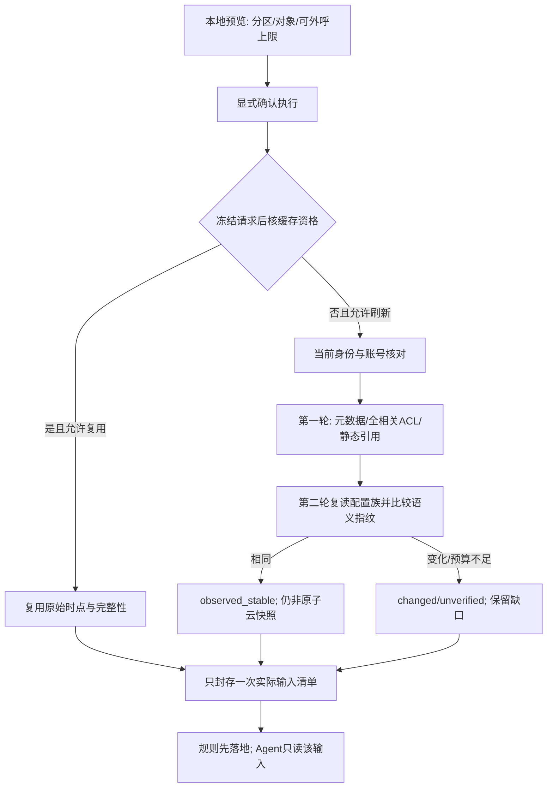

# 阿里云只读采集与边界适配

基线：需求v0.6／B2、设计v0.6，G1／G2已通过。本文为该领域的现行详细设计；实际运行验收另行取证。2026-10-30已接对话选择器、有界元数据发现、来源限定业务目录、批量／去重、结构化SG及同audit资料准备／合格复用。限定代码证据见[当前记录](../validation/evidence/conversation-implementation-local.md)，不改变E4历史人工fixture边界；真实账号、产品权限和完整M0尚未验收。

## 1. 首版执行单位：一次任务只审一个策略分区

设计选择：**一个连接／账号＋一个边界／方向＋一个实际策略集；NAT一次只选一个网关**。资产可以多选，由对话意图／辅助表单经目录解析后形成任务允许集合，不要求预先全部列入连接配置。多个边界可在同一会话分别发起、关联报告，不做一个任务跨三种边界拼出端到端路径。单批执行限制由服务端版本化profile约束；legacy的50资产只为单批未校准兼容值，不等于目录容量或产品永久上限，一台ECS案例复用与3会话并发也不限定资产规模。

这是控制语义、分页与预算复杂度的技术安排，不删去 B2 已确认的出向和 NAT 功能。同分区超单批时，经用户接受完整对象集合与分批效果，可由一个父请求顺序执行内部批段；各批独立manifest并汇总覆盖，不能截前N冒充全量。不同分区仍分别关联任务，不用`direction=all`跳过隔离。

### 1.1 三个视图不同

| 视图 | 内容 | 不能混同 |
| --- | --- | --- |
| 云读取范围 | 为完整性实际读取的策略分区、引用和关联资料 | 审计三台资产，不等于只允许读取三条 allow 策略 |
| 审计对象范围 | 指定资产／服务，或一个明确的 NAT 网关策略集 | 不自动扫描全账号资产，不把网关查询变成全 VPC 路径分析 |
| 模型可见范围 | 与已选对象／发现有关、通过字段投影的证据 | 同一私有快照包含更多对象，不等于 Agent 获得全部读取权 |

### 1.2 策略分区的规范身份

服务端维护不可变 `policy_scope_ref`，关联以下规范身份：

- provider、连接配置版本、已核对的账号引用；真实账号编号在内部按字符串保存，不经 JavaScript 浮点数处理。
- `boundary = internet | nat`；`direction = in | out`。支持组合仅为 `internet/in`、`internet/out`、`nat/out`。
- `control_plane_ref`：SDK endpoint／控制面地域配置。它不是 ECS 资产地域，不把两者拼成同一个 Region 字段。
- `policy_set_ref`：互联网为该控制面下的方向分区；NAT 为明确的网关策略集。若未来返回额外规则组且执行次序不明，标不支持，不摊平混排。
- `ip_family = ipv4`，以及语义 profile 的标识；IPv6 不默认为等价支持。

规则身份为 `(snapshot_id, policy_scope_ref, provider_acl_id)`，不能仅以 `AclUuid` 全局唯一。引用对象、默认行为、覆盖状态和证据均携带分区归属。复审比较使用稳定的规范分区键，而非两个快照中新生成的 scope 数据库 ID。

首次使用时，scope可由显式允许的边界和已解析网关生成，能力标unknown；已授权导入／既有采集也可提供目录。E4历史切片从静态边界／网关ID清单生成scope。当前连接配置提供认证、有限地域／边界与只读权限上界，对象allowlist仅额外收紧；业务目录由导入／已接受发现／采集持久化，空名单或无目录均不隐式扩大成全账号。GET目录只读本地，发现必须来自已接受意图中的有界效果，不为填充下拉框外呼。

前端和模型使用后端发放的不透明对象引用；自然语言中的名称／ID先作为选择器数据由Resolver核验，不直接充当执行权限。不得自行提交厂商endpoint、RAM action或任意MemberUid。

### 1.3 对话选择器与有界资源发现

1. 对话规划仅查本地ResourceCatalog，提取单账号上下文、有限地域、资源类型、名称／ID、边界／方向和动作。客户／租户词仅匹配有来源的已确认业务归属，缺映射时澄清，不猜标签、不切账号。
2. Resolver以`provider / account_ref / region / resource_type / provider_resource_id`核对身份，名称／标签只用于检索。先按ID精确定位或按地域／类型／名称检索；同名候选返回有界摘要并等待选择，不自动取第一条。
3. 缺目录或资料陈旧时，由同一意图生成有界`discover_region`或`explicit_ids`选择器，包含有限地域／类型，以及名称／ID／标签或显式有限地域ECS集合语义，并有页／对象／HTTP／时间上限；集合请求不强制逐个给名称或ID。用户接受proposal后通过现有collect准入执行，查询条件到厂商参数的映射须按固定适配契约核验；模型不提供任意RPC或新RAM动作。
4. 发现只收集定位所需元数据与覆盖信息并持久化目录，不对每个候选执行完整策略审计。唯一满足原条件或经用户消歧后，才固定审计对象并准备所选分区的完整配置族；歧义或超出原选择器时停止继续审计。
5. 原始ID位于已授权账号／地域／类型且不违反可选对象限制时，不因未在静态JSON预列而拒绝解析。越界仍拒绝，实际身份／响应归属不符停止；有限地域不等于允许发现全账号其他地域。
6. 目录稳定分页并保留筛选、观察时点、已覆盖页、游标与截断／错误。达到发现上限表示本次未穷尽，可继续澄清或另行有界请求，不表示目录总容量已满，也不能把部分结果说成完整空集。索引／分页检索保留规模演进空间，当前未实现或验证百万级能力。

ResourceCatalog与任务输入分别版本化：目录用于定位，审计在必要刷新后固定本次snapshot，名称变更不能改变资源身份，也不能让新目录事实覆盖历史输入。详细意图／proposal／确认绑定见[数据与API第5.4节](data-and-api.md)，产品流程见[PRD](../requirements/product.md)。

## 2. 云查询接口：只采用已核实的操作

已核对官方文档和官方 Go SDK 源码；**这些是公开契约证据，不是本项目真实账号验收**。SDK 核读提交为 `c44859c166b7f54f0cd9e48efe8890916e363ee3`，其 module 为 `github.com/alibabacloud-go/cloudfw-20171207/v11`。正式依赖标签／校验值已随工程锁定；E4已编译接入固定CFW SDK及通用ECS／STS调用，人工HTTPfixture不等真实账号字段或权限验收。

| 用途 | 采用的只读操作／请求约束 | 返回与处理 |
| --- | --- | --- |
| 互联网入向／出向 | `DescribeControlPolicy`；方向必显式选择；列表不按动作、端口、Release 或某个 AclUuid 过滤掉相关规则 | 按原互联网适配保留匹配字段、顺序、状态与高级条件；出向不能直接复用入向业务来源字段 |
| NAT 防火墙／网关元数据 | `DescribeNatFirewallList`；固定网关采集必须显式NatGatewayId；通用Name发现保留有限范围的列表结果，再精确匹配NatGatewayName或ProxyName，不把通用名称误下推为ProxyName；NAT通配名称在外呼前拒绝，再消歧取得ID；RegionNo与连接范围交叉核对，不传跨账号MemberUid | 返回 `NatFirewallList`；总数是数值；保留网关、ProxyId、VpcId、RegionId、ProxyStatus、StrictMode 与关联来源 |
| NAT ACL | `DescribeNatFirewallControlPolicy`；显式 NatGatewayId、Direction=out | 返回集合名为 **`Policys`**；总数是字符串；每项回显网关身份，必须与任务匹配 |
| 静态引用 | `DescribeAddressBook`；只查由获准策略引用的静态 IP／端口对象 | 不把域名／动态组当静态 IP；NAT 响应内联成员优先保留，缺失或截断时不声称完整 |
| ECS／安全组上下文 | 固定DescribeInstances／DescribeSecurityGroupAttribute；对话可按已接受有限范围元数据发现或定位新显式ID，同地域批量ID、按账号／地域／组去重；未接额外网卡／EIP发现API | 已接有界选择器与元数据／安全组结构化输入；同VPC、同标签或同公网IP均不能单独证明NAT流量路径 |

### 2.1 不能照搬分页类型

- 互联网和 NAT ACL 的 `CurrentPage / PageSize` 在所核 SDK 中为字符串；NAT ACL 的 `TotalCount` 也是字符串。
- NAT 元数据的 `PageNo / PageSize` 是整数；其 `TotalCount` 为整数。规范层统一为受校验的非负整数，保留原始字段证据；不静默把解析失败当零。
- NAT ACL 请求没有统一的互联网 IpVersion 筛选字段；保留完整返回，再对已知地址族判断适用性，未知条件不能因为任务只审 IPv4 就被丢弃。
- 页大小按操作的版本化profile定义；项目50不是统一厂商上限。ECS MaxResults为1～100且InstanceIds最多100；SG MaxResults为10～1000；AddressBook和NAT防火墙元数据每页最多50；当前CFW互联网／NAT ACL操作页未明文最大PageSize，不编造最大值。完整官方字段与string／integer差异见[研究§2](../research/collection-workload.md)。
- 页面必须覆盖所选策略集的全部相关动作、状态及条件。缺页、重复页、重复身份冲突、总数变化、异常空页、越界网关或数量上限触发均记录不完整。
- 请求成功并返回可信的完整空列表，才是“没有此类条目”；nil／缺字段／权限错误不能变成空集。按固定版本真实 fixture 验证缺失与空数组的区别。

### 2.2 原始字段到规范层

| 原始信息 | 规范要求 |
| --- | --- |
| 网关身份、ACL ID、顺序 | 分区内唯一；NAT 回显网关不符即拒绝该分区封存，缺失身份不能靠名称猜补 |
| Release／动作／协议 | 三态启用、规范动作与协议；未知枚举保留，不映射成 disabled／accept |
| 来源、目标和类型 | 保留字面地址、静态引用、域名或动态类型；出向仍以资产为发起方、外部地址为目标 |
| NAT 内联 CIDR／端口组成员 | 仅在结构与完整性满足固定适配契约时展开；缺失不是空组，不执行字符串或把字符串示例当数组 |
| 应用、域名解析、重复时段／有效期 | 原始条件不丢失；超出支持的相关条件使计算降级，不因 DNSResult 存在就把域名改成永久 IP 白名单 |
| HitTimes／最近命中 | 仅保留事实来源，不进入首版“零命中删规则”判断，也不进入配置稳定性指纹 |

SDK型别与文档示例有歧义时，标为待真实fixture核验；不能用容错解析偷偷扩大支持语义。原文只存私有目录，不成为公共DTO。

### 2.3 元数据与画像资料的封存要求

- 元数据保留账号／地域／资源类型／原始ID、名称、标签、系统类型、地址和关联组／网卡；字段缺失为unknown，不能补成空标签或从ID猜类型。字段的来源、采集窗口、schema／normalizer与覆盖版本随目录和快照保存。
- 安全组只在所选实例返回明确关联后读取，规范化方向、动作、协议、地址／端口、顺序／状态、引用及未支持条件，保留资产—组关联证据和完整性。共享组、多网卡、引用未知等情况降级，不仅抽端口推断真实服务。
- Agent从本次封存section读取获准元数据和安全组证据；角色候选须有证据／缺项，并进入共用草稿预览确认，名称／标签／端口不证明监听、可达或业务授权。查询过私有原文不等于已供Agent使用。
- 当前Asset规范输入已保存来源限定ID、名称／标签／地域／类型、系统与关联元数据，安全组规则已结构化到固定输入并供受控工具按已返回引用补查。complete-empty、partial、not_collected分别表达，未知高级条件保留；范围内结构化SG仍不是完整安全组审计、真实监听证明或画像质量验收。

## 3. 覆盖、严格模式和默认行为

`ProxyStatus` 映射为控制面状态：normal 为正常，closed 为关闭；opening／closing／configuring／deleting 为过渡态；abnormal 单列异常；未知枚举保持未知。它不证明每台 ECS 的实际流量已走该网关，也不证明策略下发或业务连通。

`StrictMode=1/0` 记录 ACL 引擎严格／非严格模式，**不能把 1 直接映射为未命中默认拒绝**。引擎模式涉及应用识别行为，默认动作应由独立的版本化 `provider_semantics` 明确给出。官方匹配说明包含优先级、默认放行与应用识别的边界（T-06）；观察动作按策略动作定义单独保留（T-01）；不能用安全组默认拒绝取代 CFW 语义。

设计采用显式 `default_action = accept | drop | unknown`、`default_evidence_ref`、`semantics_profile_id` 和 `verified_for_partition`。公开资料支持某 profile 不等于它已核实适用于用户账号。profile 未匹配／规则组含义未知时，未命中的查询为 unknown；完整的显式命中可以在其他前提满足时单独分析。

观察动作不是拒绝；本版不计算涉及观察／复杂 L7 的完整路径，相关查询给出 unsupported。与当前查询可证明无关的高级规则可排除，不牵连全部检查。

## 4. 采集流水线与一致性

- 一次真实只读刷新最多两轮完整配置族读取，不无限重试追逐“最新”。两轮均计入同一任务／会话／应用更严额度与根时限。原100次／90秒现为legacy未校准兼容值，实际读取统一effective profile，不能当产品永久能力；也不能因新增边界或批次自动扩大私有授权。
- 比较完整规则条件、顺序、启用、引用成员、默认语义相关元数据和保护状态；忽略命中计数等运行统计。原文摘要与配置语义摘要分别保存。
- 两轮一致只表示观察窗口内两次配置表示相同，**不是事务级快照或永不变化证明**。API 无原子版本保证时报告明确说明。
- 已观察到配置变化、页数矛盾或第二轮未完成时，配置路径检查不得输出“通过”；可以保留来源明确的静态观察和不依赖缺失部分的事实，标出局限。
- NAT 配置族包含指定网关元数据、该网关 out ACL 和适用的引用；互联网按方向／控制面组成配置族。不能把入向缓存当出向缓存，或把网关 A 的资料给 B。
- 各族记录started_at／finished_at、请求过滤、页数、原始来源、复用来源、枚举完整性与观察一致性。快照created_at不给旧资料续新。
- 合格缓存复用与按需刷新是M0必需能力，按账号／规范分区／选择器、采集／规范化版本和数据族时点核对；目录时效不能代替CFW／引用／保护配置族时效。已接受审计意图中的必要刷新沿用原效果与预算，固定资料九工具不参与云读取；定时采集另为默认关闭的可选入口。

离线固定制品与内置 synthetic 用例不伪造两次云读取，可标 fixed_artifact 并记录文件／内容版本；这只证明输入制品固定，不证明它是真实云端全量。外部导入自行声明完整不能升级为可信云全量；在声明完整且结构／引用闭合的固定输入上，只能形成 imported_assumption 的条件配置推导。显式缺页、未知引用或未声明覆盖仍须降级，不能用假设覆盖已知缺口。人工构造案例的完整性是明确的案例设定，不是生产真实性证据。

两轮复读是**真实刷新**的当前保守默认，后续如果厂商提供可靠版本／快照机制，可替换为经验证的更低开销实现；未经变更记录不静默改为抽查第一页。

## 5. NAT 的关联层，不是路由模拟器

区分两种明确的审计对象：

1. **网关策略集**：按一个用户选定网关审查其 ACL 条件、精确重复候选与当前控制面状态；可以没有资产列表，但必须显式选择 `gateway_policy` 模式，不把空资产列表当全账号。
2. **指定资产的 NAT 业务关系**：需要该资产／地址与目标网关的有来源关联、观察位置、已确认外部依赖。缺少这些时，资产级业务检查给信息不足；网关级静态检查仍可独立执行。

ECS 私网 IP、同 VPC、NatRouteEntryList 或操作者选择了一个网关，均不单独证明端到端路径。记录 `association_state = evidenced | candidate | unknown | conflict`，说明证明的是配置关系还是实际路径；首版没有实际路径证明状态。

SNAT／DNAT 条目仅接受显式提供的、有来源与时点的关联上下文；默认不新增转换表 API，不模拟转换。若 B2 真实案例确需最小只读补证，应在 G2 中明确新增 API／RAM／字段／预算，不由 Agent 即时扩权。NAT 查询中的未采集转换信息不等于“没有 NAT”。

## 6. SDK、取消与请求预算

所核官方 v11 源码提供 `DescribeControlPolicyWithContext`、`DescribeNatFirewallControlPolicyWithContext`、`DescribeNatFirewallListWithContext` 等，并传入 `CallApiWithCtx`（T-05）。设计要求适配器使用这些 context 路线，传入任务根剩余 deadline，而不是普通请求函数外套一个超时协程。

E4已接固定SDK的WithContext／CallApiWithCtx、共享物理HTTP准入和静态Provider，当前人工fixture验证与待真实核对项见[E4适配记录](../validation/evidence/e4-adapters-local.md)。自动凭据续期尚未实现，不能把固定SDK编译或人工响应当真实身份／权限／分页验收。工作器只持 typed job context，不持已经结束的 Gin Context。

- 运行层关闭无法计数的隐式自动重试，使用唯一的有界重试责任层；SDK／凭据请求如何纳入真实 HTTP 尝试账本必须通过模拟端点验收。
- NAT 两个查询的官方 RAM 读取动作为 `yundun-cloudfirewall:DescribeNatFirewallList` 和 `yundun-cloudfirewall:DescribeNatFirewallControlPolicy`（T-01／02）；接口授权表的资源范围不能被误写成已经实现网关级 RAM 隔离。
- 官方授权表提供资源类型：策略操作按 NatFirewallControlPolicy／AclUuid，元数据操作按 NatFirewall／ProxyId；它们不等于查询参数 NatGatewayId。应优先使用账号限定的资源 ARN／已知资源范围，并实测列表完整性；为枚举完整策略集需要更宽资源模式时须显式说明，不宣称已做到逐网关隔离。禁止全动作 `*`、FullAccess 或写 API，不能因为需要列表就默认整套全权限。
- expected account 不符、返回跨账号／网关数据、Provider 过期失败、权限拒绝均停止受影响读取；不尝试机器全局 profile 或其他 MemberUid。
- 本文参数不是当前授权。E4已执行SDK编译与人工loopback HTTP协议回归，未向真实RAM／STS／云／模型服务发请求，也未下发权限策略。

## 7. 能力状态与降级

| 情形 | 对用户显示 | 系统行为 |
| --- | --- | --- |
| 公共文档有接口，目标账号尚未验证 | 接口适配设计已具备，真实能力未验证 | 用户后续明确的连接检查／采集才允许尝试；配置检查零外呼 |
| NAT 产品未就绪／无权限 | 受影响边界不可采集及恢复入口 | 保留离线入口；不把账号其它边界也判无数据，不自动开通产品 |
| 已选网关未出现在完整查询中 | 指定对象未取得／需核对 | 不直接认定云上网关不存在或没有防护 |
| 语义／成员／模式不能核实 | 信息不足或不支持，定位受影响检查 | 保留事实和原文证据，不运行“简化后必通过”的规则 |
| G2 后真实 NAT 验收条件不具备 | NAT 真实接入未验收 | 离线案例不能替代它；是否调整最终验收需用户决定 |

对应验证见 [B2-01～18](../validation/verification-plan.md)。

### 7.1 RAM 资源标识与查询 owner 不同

当前官方页面给出的资源格式分别为 `acs:cloudfirewall::{account_id}:natfirewallcontrolpolicy/{AclUuid}` 和 `acs:cloudfirewall::{account_id}:natfirewall/{ProxyId}`（T-01／02）。本文件展示的是文档格式，不是已下发的策略。NatGatewayId 不能被随意替换进 ProxyId／AclUuid 的位置。

如果仅授予已知若干 ACL 而列表因此漏掉其他相关前置规则，就无法完成全分区语义证明。G2 后需在 RAM／OpenAPI 实际验收资源模式、查询参数与完整性的组合；应用 scope 和模型投影继续约束数据用途，但不伪装为上游 RAM 已具备同样粒度。

## 8. 稳定需求下的执行衔接

对话目标链为：无snapshot会话→意图提取→本地目录解析／澄清→proposal确认→现有执行准入→有界发现／M0合格复用或必要刷新→一次封存→审计。初次已接受的对象条件和效果可覆盖数据准备及后续审计，不要求每个HTTP或每个内部阶段再授权；对象歧义、范围或效果扩大时须重新核对，不能让模型自行提升权限。该链已在正式Go应用服务和Vue对话接通，并通过限定人工数据验证；完整24旅程／88分支尚未验收。

当前正式audit准备可在原接受范围内执行有限元数据发现及后续采集，未知显式ECS ID在单个明确地域也可先发现后分批。独立collect仍保留明确assets或NAT gateway_policy入口，未注册通用discover_region请求字段，不提供空列表全账号发现。E4历史collect→另行pinned audit证据仍按原两步切片解释，不再作为产品必须手工选快照的限制。

配置族读取的真实 HTTP、凭据交换、重试和大响应限制共用统一准入与账本；源码存在 WithContext 不代表已验证所有物理请求控制。两轮观测一致不是原子快照；大响应或未穷尽仍不能通过。

真实验证优先同一台 ECS／防火墙串行切换。每例保存 baseline、前后 snapshot、人工变更与还原记录，至少一次真实整改后强制刷新并复审；对象／网关／观察点变化不能误报修复。NAT 必要资源单列最小清单，不因复用删去 NAT 验收。具体流程见 [评价计划](../validation/evaluation-plan.md)。

## 9. 并发采集

3个任务槽位不改变每任务一个分区／一个NAT网关；云与凭据物理HTTP的全应用并发仍最多2，统一原子账本和根预算。默认不把不同任务的刷新查询合并为同一个可被他人取消的执行；仅复用已提交合格快照。Provider续期隔离、有界等待、响应上限及故障行为按[总体架构](architecture.md)验证，不追加云API或RAM权限。

## 10. E4历史切片、当前适配与尚未验收范围

当前cloudconfig只读取显式--cloud-config JSON及其点名环境变量，连接声明单账号、有限地域／边界和固定只读操作上界；资产／网关allowlist仅额外收紧。来源限定resource_catalog与configured_scope_catalog分离，新ID经原地域／类型范围校验后可发现，不再要求逐台预列。生产端点固定，aliyunapi仅开放CFW五操作、ECS两操作和GetCallerIdentity；先核expected account及受支持身份／ARN再允许产品读取，关联安全组必须先从所选ECS返回。当前静态env_ak／env_sts无自动续期、AssumeRole或ECS角色Provider。

aliyuncollector对固定选择最多读两轮配置族，区分页号／字符串总数与NextToken；保留重复／缺字段／未知条件／引用冲突、采集窗口和语义指纹。静态地址簿双表示冲突或畸形保持未知，不选其中一种证明完整。默认动作始终unknown；同VPC、私网地址或NAT元数据不生成evidenced关联，未获业务确认不推角色、监听或允许集合。安全组读取提供范围内结构化上下文与私有原文；Agent可通过已返回的组引用取受控规则，不等完整安全组审计或实际可达证明。

两轮保护状态按规范对象单独核对：互联网固定输入的`assets[].protection`分别保存所选资产状态及证据，不能把同批一台open／另一台closed聚成unknown后丢掉明确关闭事实。每台资产的明确冲突降unknown并记PROTECTION_CHANGED；后轮未取得或未知记PROTECTION_UNVERIFIED，不能让其他资产的稳定状态代替它。两轮状态一致但仅后续ACL读取或其他资产读取失败时，该对象独立保护事实可保留，ACL完整性仍降级；原始两轮证据不被覆盖。分区`protection`保留为汇总／旧固定输入的兼容断言；NAT仍按同一网关分区状态判断，不从资产字段覆盖网关状态。

所有云／凭据／模型物理HTTP共用一个Manager、同一预算周期与持久预记；同时启用的两份配置Ref须一致，模型额度／到期取严，显式0仍为0。当前schema 5在网络工作完成后，以短事务原子保存snapshot、sealed输入、CloudRecord、公开应用消息及终态；原始响应按原bytes哈希并base64存私有列，不进入cloud_result或报告，取消／重启不重放。

connection_check当前仅身份核对，返回IDENTITY_ONLY的partial结果，product_ready=false，不证明产品权限／字段／分页。GET collection-options只读本地配置，identity_verified不因此变真。当前SDK→HTTP→账本→Collector→数据库→独立审计／报告的链路均由人工fixture供数据；即使输入标live_readonly，也只能说明经过受控采集代码路径，不是用户账号真实云观测。已通过的限定本机数字与局限见[E4适配记录](../validation/evidence/e4-adapters-local.md)。

仍需真实身份／权限、账号产品就绪、字段／分页／范围、静态STS与错误行为分项验证；至少一次人工整改→重采集→复审及E5的20～30独立案例／公平比较尚未执行。对话规划／消歧／目录、有界发现、元数据／安全组结构化输入、M0完整snapshot合格复用及串行分批已落代码与限定离线验证；完整客户分支与真实质量仍待验收，自动角色Provider与默认关闭的可选定时采集也不能因当前切片接通而宣称交付。

合法、可校验的partial输入保留已得ECS／CFW／SG等独立事实及受影响缺口；不安全或fatal协议结果不构造输入。已取得的安全观察可作为product_ready=false、无snapshot的CloudRecord单独落库，界面明确部分读取／未封存，不输出原始正文。取消已生效后的迟到成功不能新封存，保留观察也不重新发请求。

identity_only身份计划不要求资产清单，只核所选显式连接的GetCallerIdentity，IDs／gateway_ref为空；与collect／audit产品读取保持分离。复审还核NAT原始provider／账号／网关ID／地域／类型；即使本地scope或gateway别名未变，原始身份变化仍不可比，名称变更本身不等身份变化。

## 11. 批量、去重与合格复用的现行实现

按[架构](architecture.md)采用按需首次采集＋已提交不可变缓存；可选定时默认关闭。首版不合并进行中的刷新，避免一个任务取消牵连其他任务或混合授权；3会话同时冷刷仍分别计入共享账本。

1. 目录发现与正式输入采集分开。发现只取定位元数据，保留名称、标签、ID、地域、类型及覆盖／游标；解析后明确所选对象，不能为每个候选读取整套ACL／SG。ECS名称可能重复，标签过滤有官方结果规模限制，收窄／未穷尽须可见，不能承诺无限全账号搜索。
2. 明确对象后，同地域ECS按官方最多100个ID分批，真实token继续读；返回ID逐个核归属、缺失、重复和冲突。CFW资产不能假造批量ID参数，获准完整切片可枚举一次本地关联；不允许更宽切片则仍逐ID。RegionNo与资产地域分开。
3. SG按账号／地域／组ID去重，保留每台资产到组的来源关联；每个组完整双方向读取一次。组共享不等每个资产角色相同，多网卡关系不全明确降级；如需DescribeNetworkInterfaces另补已批准只读动作与参数契约。
4. 每个策略方向／网关每轮只完整枚举一次ACL，所有动作、状态、优先级、引用、高级条件保留；引用按稳定身份去重，名称模糊查询后精确核名／类型，不把UUID与名称混用。不能按每台IP／端口过滤策略以换取假完整。两轮屏障保留，每轮去重缓存不跨两轮抹掉配置变化。
5. 构建规范对象、关联、策略、静态引用及保护状态索引，规则复用共享策略输入；按对象计算可适用端点／集合。规则成本受计算单元保护，超限标未穷尽，不将模型调用次数设为资产数。
6. 当前M0的CacheEligibility对完整候选snapshot检查目录来源、资产关联、SG、CFW策略／保护／引用族；配置族整体一致，关联变化使依赖族重新评估。缓存键绑定账号／授权scope版本、规范分区、对象与覆盖、采集窗口、schema／normalizer／语义及适配版本，已知变更／fresh_after／不完整均不能满足当前检查。
7. 合格复用保留原section与时间，热复用不查身份亦可零云HTTP；有任何新读取则先按当前凭据核身份。封存manifest只包含获准投影，不因缓存更宽把全部数据交给Agent。新建快照不续鲜，云资料相同也不复用不同业务／规则版本的结论。
8. 任意族拼接与只刷新必要族尚未交付，当前资格不足时按已接受有限范围采集。后续若实现必要族刷新，须按完整族重读且核依赖，不抽首页证明未变；某族失败保留其他独立事实，相关检查信息不足。已声明整改后的force_refresh失败，不回退旧资料冒充当前。

请求公式及20资产131／61／23等**人工算例**统一见[研究§5](../research/collection-workload.md)。当前基础路线为批量ECS＋SG去重、每轮ACL／引用共享且CFW逐ID；20人工资产签名loopback记录61次物理尝试。更宽CFW切片优化须另有已接受读取范围，23等人工路线不宣称已交付；不以抬高100次legacy值替代完整性设计。实际RTT、页分布、限流、重试与模型耗时未测，不承诺固定秒数。

可离线验证：多地域ID批量／缺ID，共享SG只读一次且关联保留，完整ACL供20对象共享，引用去重，两轮变化与中断，目录／缓存范围或版本不合格，强刷失败不称修复，3会话用量取严。真实账号再核RAM、字段、分页、产品状态、阶段耗时和人工整改；HTTP fixture不替代真实能力。
