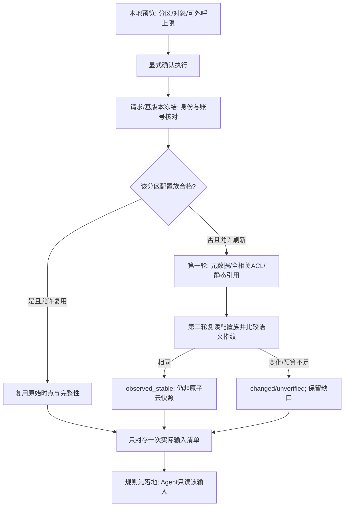

# 阿里云只读采集与边界适配

基线：需求v0.6／B2、设计v0.6，G1／G2已通过。本文为该领域的现行详细设计；实际运行验收另行取证。

## 1. 首版执行单位：一次任务只审一个策略分区

设计选择：**一个连接／账号＋一个边界／方向＋一个实际策略集；NAT 一次只选一个网关**。资产可以多选，但必须属于该任务允许的集合。多个边界可以在同一业务会话内分别发起、分别关联报告，不做一个任务跨三种边界拼出端到端路径。

这是控制语义、分页与预算复杂度的技术安排，不删去 B2 已确认的出向和 NAT 功能。未来若支持多分区父任务，需要重新设计分区状态／预算和汇总，不能现在用一个 `direction=all` 字段跳过隔离。

### 1.1 三个视图不同

| 视图 | 内容 | 不能混同 |
| --- | --- | --- |
| 云读取范围 | 为完整性实际读取的策略分区、引用和关联资料 | 审计三台资产，不等于只允许读取三条 allow 策略 |
| 审计对象范围 | 指定资产／服务，或一个明确的 NAT 网关策略集 | 不自动扫描全账号资产，不把网关查询变成全 VPC 路径分析 |
| 模型可见范围 | 与已选对象／发现有关、通过字段投影的证据 | 同一私有快照包含更多对象，不等于 Agent 获得全部读取权 |

### 1.2 策略分区的规范身份

服务端维护不可变 `policy_scope_ref`，关联以下规范身份：

- provider、连接配置版本、已核对的账号引用；真实账号编号在内部按字符串保存，不经 JavaScript 浮点数处理。
- `boundary = internet | nat`；`direction = in | out`。支持组合仅为 `internet/in`、`internet/out`、`nat/out`。
- `control_plane_ref`：SDK endpoint／控制面地域配置。它不是 ECS 资产地域，不把两者拼成同一个 Region 字段。
- `policy_set_ref`：互联网为该控制面下的方向分区；NAT 为明确的网关策略集。若未来返回额外规则组且执行次序不明，标不支持，不摊平混排。
- `ip_family = ipv4`，以及语义 profile 的标识；IPv6 不默认为等价支持。

规则身份为 `(snapshot_id, policy_scope_ref, provider_acl_id)`，不能仅以 `AclUuid` 全局唯一。引用对象、默认行为、覆盖状态和证据均携带分区归属。复审比较使用稳定的规范分区键，而非两个快照中新生成的 scope 数据库 ID。

首次使用时，scope 可由服务端显式允许的边界／网关 ID 清单生成，能力标 unknown；也可来自已授权的导入／既有采集。空网关名单不扩大成全账号；GET 目录只读本地，不为填充下拉框触发发现请求。

前端和模型只传后端发放的不透明引用，不自行提交厂商 endpoint、RAM action 或任意 MemberUid。

## 2. 云查询接口：只采用已核实的操作

已核对官方文档和官方 Go SDK 源码；**这些是公开契约证据，不是本项目真实账号验收**。SDK 核读提交为 `c44859c166b7f54f0cd9e48efe8890916e363ee3`，其 module 为 `github.com/alibabacloud-go/cloudfw-20171207/v11`。正式依赖标签／校验值在 G2 后锁定，不将源码读取当成编译成功。

| 用途 | 采用的只读操作／请求约束 | 返回与处理 |
| --- | --- | --- |
| 互联网入向／出向 | `DescribeControlPolicy`；方向必显式选择；列表不按动作、端口、Release 或某个 AclUuid 过滤掉相关规则 | 按原互联网适配保留匹配字段、顺序、状态与高级条件；出向不能直接复用入向业务来源字段 |
| NAT 防火墙／网关元数据 | `DescribeNatFirewallList`；显式 NatGatewayId，必要时 RegionNo 与连接范围交叉核对；不传跨账号 MemberUid | 返回 `NatFirewallList`；总数是数值；保留网关、ProxyId、VpcId、RegionId、ProxyStatus、StrictMode 与关联来源 |
| NAT ACL | `DescribeNatFirewallControlPolicy`；显式 NatGatewayId、Direction=out | 返回集合名为 **`Policys`**；总数是字符串；每项回显网关身份，必须与任务匹配 |
| 静态引用 | `DescribeAddressBook`；只查由获准策略引用的静态 IP／端口对象 | 不把域名／动态组当静态 IP；NAT 响应内联成员优先保留，缺失或截断时不声称完整 |
| ECS／安全组上下文 | 既有 DescribeInstances／DescribeSecurityGroupAttribute 及必要网卡资料 | 仅有限对象；同 VPC、同标签或同公网 IP 都不能单独证明 NAT 流量路径 |

### 2.1 不能照搬分页类型

- 互联网和 NAT ACL 的 `CurrentPage / PageSize` 在所核 SDK 中为字符串；NAT ACL 的 `TotalCount` 也是字符串。
- NAT 元数据的 `PageNo / PageSize` 是整数；其 `TotalCount` 为整数。规范层统一为受校验的非负整数，保留原始字段证据；不静默把解析失败当零。
- NAT ACL 请求没有统一的互联网 IpVersion 筛选字段；保留完整返回，再对已知地址族判断适用性，未知条件不能因为任务只审 IPv4 就被丢弃。
- 页大小通过版本化适配 profile 决定，初始建议不高于 50 且不超过接口文档上限；不能向所有操作统一传未经核实的最大值。
- 页面必须覆盖所选策略集的全部相关动作、状态及条件。缺页、重复页、重复身份冲突、总数变化、异常空页、越界网关或数量上限触发均记录不完整。
- 请求成功并返回可信的完整空列表，才是“没有此类条目”；nil／缺字段／权限错误不能变成空集。按固定版本真实 fixture 验证缺失与空数组的区别。

### 2.2 原始字段到规范层

| 原始信息 | 规范要求 |
| --- | --- |
| 网关身份、ACL ID、顺序 | 分区内唯一；NAT 回显网关不符即拒绝该分区封存，缺失身份不能靠名称猜补 |
| Release／动作／协议 | 三态启用、规范动作与协议；未知枚举保留，不映射成 disabled／accept |
| 来源、目标和类型 | 保留字面地址、静态引用、域名或动态类型；出向仍以资产为发起方、外部地址为目标 |
| NAT 内联 CIDR／端口组成员 | 仅在结构与完整性满足固定适配契约时展开；缺失不是空组，不执行字符串或把字符串示例当数组 |
| 应用、域名解析、重复时段／有效期 | 原始条件不丢失；超出支持的相关条件使计算降级，不因 DNSResult 存在就把域名改成永久 IP 白名单 |
| HitTimes／最近命中 | 仅保留事实来源，不进入首版“零命中删规则”判断，也不进入配置稳定性指纹 |

SDK 型别与文档示例有歧义时，标为待真实 fixture 核验；不能用容错解析偷偷扩大支持语义。原文只存私有目录，不成为公共 DTO。

## 3. 覆盖、严格模式和默认行为

`ProxyStatus` 映射为控制面状态：normal 为正常，closed 为关闭；opening／closing／configuring／deleting 为过渡态；abnormal 单列异常；未知枚举保持未知。它不证明每台 ECS 的实际流量已走该网关，也不证明策略下发或业务连通。

`StrictMode=1/0` 记录 ACL 引擎严格／非严格模式，**不能把 1 直接映射为未命中默认拒绝**。引擎模式涉及应用识别行为，默认动作应由独立的版本化 `provider_semantics` 明确给出。官方匹配说明包含优先级、默认放行与应用识别的边界（T-06）；观察动作按策略动作定义单独保留（T-01）；不能用安全组默认拒绝取代 CFW 语义。

设计采用显式 `default_action = accept | drop | unknown`、`default_evidence_ref`、`semantics_profile_id` 和 `verified_for_partition`。公开资料支持某 profile 不等于它已核实适用于用户账号。profile 未匹配／规则组含义未知时，未命中的查询为 unknown；完整的显式命中可以在其他前提满足时单独分析。

观察动作不是拒绝；本版不计算涉及观察／复杂 L7 的完整路径，相关查询给出 unsupported。与当前查询可证明无关的高级规则可排除，不牵连全部检查。

## 4. 采集流水线与一致性

- 一次真实只读刷新最多两轮完整配置族读取，不无限重试追逐“最新”。两轮均计入原 100 次 HTTP／90 秒采集预算，不能因新增边界自动扩大。
- 比较完整规则条件、顺序、启用、引用成员、默认语义相关元数据和保护状态；忽略命中计数等运行统计。原文摘要与配置语义摘要分别保存。
- 两轮一致只表示观察窗口内两次配置表示相同，**不是事务级快照或永不变化证明**。API 无原子版本保证时报告明确说明。
- 已观察到配置变化、页数矛盾或第二轮未完成时，配置路径检查不得输出“通过”；可以保留来源明确的静态观察和不依赖缺失部分的事实，标出局限。
- NAT 配置族包含指定网关元数据、该网关 out ACL 和适用的引用；互联网按方向／控制面组成配置族。不能把入向缓存当出向缓存，或把网关 A 的资料给 B。
- 各族记录 started_at／finished_at、请求过滤、页数、原始来源、复用来源、枚举完整性与观察一致性。快照 created_at 不给旧资料续新。

离线固定制品与内置 synthetic 用例不伪造两次云读取，可标 fixed_artifact 并记录文件／内容版本；这只证明输入制品固定，不证明它是真实云端全量。外部导入自行声明完整不能升级为可信云全量；在声明完整且结构／引用闭合的固定输入上，只能形成 imported_assumption 的条件配置推导。显式缺页、未知引用或未声明覆盖仍须降级，不能用假设覆盖已知缺口。人工构造案例的完整性是明确的案例设定，不是生产真实性证据。

两轮复读是**真实刷新**的当前保守默认，后续如果厂商提供可靠版本／快照机制，可替换为经验证的更低开销实现；未经变更记录不静默改为抽查第一页。

## 5. NAT 的关联层，不是路由模拟器

区分两种明确的审计对象：

1. **网关策略集**：按一个用户选定网关审查其 ACL 条件、精确重复候选与当前控制面状态；可以没有资产列表，但必须显式选择 `gateway_policy` 模式，不把空资产列表当全账号。
2. **指定资产的 NAT 业务关系**：需要该资产／地址与目标网关的有来源关联、观察位置、已确认外部依赖。缺少这些时，资产级业务检查给信息不足；网关级静态检查仍可独立执行。

ECS 私网 IP、同 VPC、NatRouteEntryList 或操作者选择了一个网关，均不单独证明端到端路径。记录 `association_state = evidenced | candidate | unknown | conflict`，说明证明的是配置关系还是实际路径；首版没有实际路径证明状态。

SNAT／DNAT 条目仅接受显式提供的、有来源与时点的关联上下文；默认不新增转换表 API，不模拟转换。若 B2 真实案例确需最小只读补证，应在 G2 中明确新增 API／RAM／字段／预算，不由 Agent 即时扩权。NAT 查询中的未采集转换信息不等于“没有 NAT”。

## 6. SDK、取消与请求预算

所核官方 v11 源码提供 `DescribeControlPolicyWithContext`、`DescribeNatFirewallControlPolicyWithContext`、`DescribeNatFirewallListWithContext` 等，并传入 `CallApiWithCtx`（T-05）。设计要求适配器使用这些 context 路线，传入任务根剩余 deadline，而不是普通请求函数外套一个超时协程。

这只解决“存在可传 context 的接口”这一证据缺口；固定 SDK、HTTP transport、凭据续期、实际取消与重试行为仍须 G2 后测试。工作器只持 typed job context，不持已经结束的 Gin Context。

- 运行层关闭无法计数的隐式自动重试，使用唯一的有界重试责任层；SDK／凭据请求如何纳入真实 HTTP 尝试账本必须通过模拟端点验收。
- NAT 两个查询的官方 RAM 读取动作为 `yundun-cloudfirewall:DescribeNatFirewallList` 和 `yundun-cloudfirewall:DescribeNatFirewallControlPolicy`（T-01／02）；接口授权表的资源范围不能被误写成已经实现网关级 RAM 隔离。
- 官方授权表提供资源类型：策略操作按 NatFirewallControlPolicy／AclUuid，元数据操作按 NatFirewall／ProxyId；它们不等于查询参数 NatGatewayId。应优先使用账号限定的资源 ARN／已知资源范围，并实测列表完整性；为枚举完整策略集需要更宽资源模式时须显式说明，不宣称已做到逐网关隔离。禁止全动作 `*`、FullAccess 或写 API，不能因为需要列表就默认整套全权限。
- expected account 不符、返回跨账号／网关数据、Provider 过期失败、权限拒绝均停止受影响读取；不尝试机器全局 profile 或其他 MemberUid。
- 本文参数不是当前授权；没有执行 RAM、STS、云／模型请求或 SDK 构建。

## 7. 能力状态与降级

| 情形 | 对用户显示 | 系统行为 |
| --- | --- | --- |
| 公共文档有接口，目标账号尚未验证 | 接口适配设计已具备，真实能力未验证 | 用户后续明确的连接检查／采集才允许尝试；配置检查零外呼 |
| NAT 产品未就绪／无权限 | 受影响边界不可采集及恢复入口 | 保留离线入口；不把账号其它边界也判无数据，不自动开通产品 |
| 已选网关未出现在完整查询中 | 指定对象未取得／需核对 | 不直接认定云上网关不存在或没有防护 |
| 语义／成员／模式不能核实 | 信息不足或不支持，定位受影响检查 | 保留事实和原文证据，不运行“简化后必通过”的规则 |
| G2 后真实 NAT 验收条件不具备 | NAT 真实接入未验收 | 离线案例不能替代它；是否调整最终验收需用户决定 |

对应验证见 [26 的 B2-01～18](../validation/verification-plan.md)。

### 7.1 RAM 资源标识与查询 owner 不同

当前官方页面给出的资源格式分别为 `acs:cloudfirewall::{account_id}:natfirewallcontrolpolicy/{AclUuid}` 和 `acs:cloudfirewall::{account_id}:natfirewall/{ProxyId}`（T-01／02）。本文件展示的是文档格式，不是已下发的策略。NatGatewayId 不能被随意替换进 ProxyId／AclUuid 的位置。

如果仅授予已知若干 ACL 而列表因此漏掉其他相关前置规则，就无法完成全分区语义证明。G2 后需在 RAM／OpenAPI 实际验收资源模式、查询参数与完整性的组合；应用 scope 和模型投影继续约束数据用途，但不伪装为上游 RAM 已具备同样粒度。

## 8. 稳定需求下的执行衔接

collect 可以按明确的 explicit_ids 或 discover_region 选择器建立有限资源目录，预算与范围在采集计划中展示；审计则只接受固定 assets／gateway_policy。发现完成后再选择审计对象，不在 audit 中把空列表升级为扫描全账号。

配置族读取的真实 HTTP、凭据交换、重试和大响应限制共用统一准入与账本；源码存在 WithContext 不代表已验证所有物理请求控制。两轮观测一致不是原子快照；大响应或未穷尽仍不能通过。

真实验证优先同一台 ECS／防火墙串行切换。每例保存 baseline、前后 snapshot、人工变更与还原记录，至少一次真实整改后强制刷新并复审；对象／网关／观察点变化不能误报修复。NAT 必要资源单列最小清单，不因复用删去 NAT 验收。具体流程见 [评价计划](../validation/evaluation-plan.md)。

## 9. 并发采集

3个任务槽位不改变每任务一个分区／一个NAT网关；云与凭据物理HTTP的全应用并发仍最多2，统一原子账本和根预算。默认不把不同任务的刷新查询合并为同一个可被他人取消的执行；仅复用已提交合格快照。Provider续期隔离、有界等待、响应上限及故障行为按[总体架构](architecture.md)验证，不追加云API或RAM权限。
