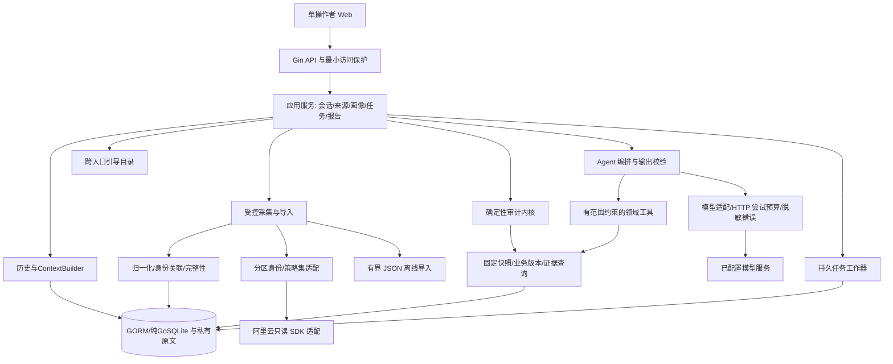
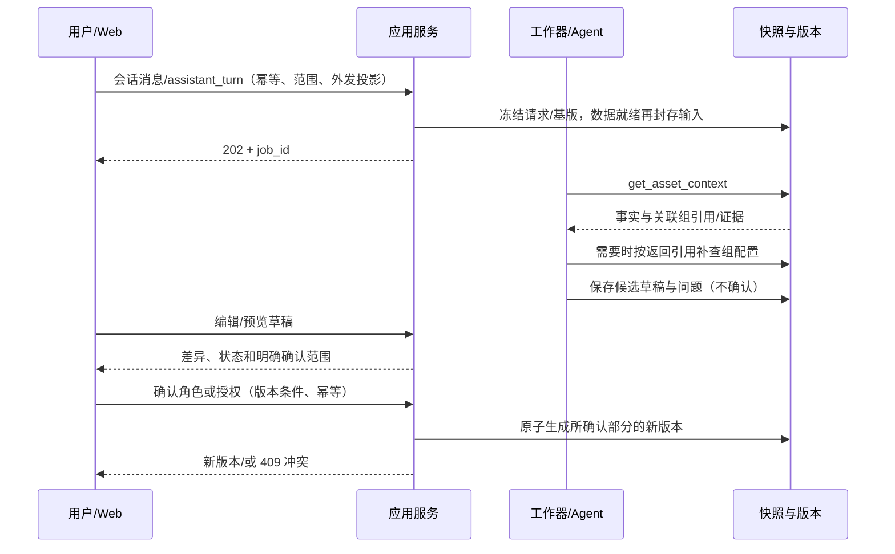

# 系统架构与总体设计

基线：需求v0.6／B2、设计v0.6，G1／G2已通过。本文为该领域的现行详细设计；实际运行验收另行取证。

E0已建立`server/`与`web/`最小骨架，限定验证见[E0记录](../validation/evidence/e0-local.md)。下文完整业务模块仍是目标设计，不因联调骨架存在而视为已实现。

E1已实现确定性离线内核、固定输入与证据、审阅／公开报告和配置复审持久链，范围与未覆盖项见[E1记录](../validation/evidence/e1-local.md)；正式会话／任务／五视图在E2接入，受限Agent在E3接入。

## 1. 设计目标与明确边界

- 用单个可演示的应用完成数据准备、画像确认、规则／Agent 审计、审阅和复审，而不是搭建通用安全平台。
- 真实采集和离线导入归一化到同一输入；结论保留范围、时点、版本、完整性和证据。
- 规则输出不被模型覆盖；Agent 具备实际工具选择与依赖补查空间，但权限、数据和预算由后端控制。
- 只读云接口；确认／待办只改本地业务资料，不修改标签、安全组、CFW 或产品开关。
- 不接云安全中心、不安装客户端、不主动扫描；不做多云、多 Agent、完整拓扑、自动修复、RAG／向量库和微服务。
- 入向沿用 CHK-01～08；出向／NAT 按 B2 和规则设计的适用矩阵执行，不机械反转入向基线。IPS／日志精确检查 M1 默认关闭。WAF 等只有条件性核查建议，不成为新的 API 或采购依赖。

容量演练可以使用 3～10 个合成资产、约 200 条策略；这不是云资源下限或已测容量。正式评价须提供 20～30 个独立人工案例，真实验证优先复用同一台 ECS／同一套云防火墙串行切换并还原配置。NAT 必要关联资源单列最小清单；不能用资源复用删掉既定边界验收。每任务仍只审一个分区／一个 NAT 网关，硬限制与降级见[规则与Agent](audit-and-agent.md)／[会话与执行](session-and-execution.md)。

## 2. 技术取舍与 ADR 摘要

一手资料编号见 [参考索引](../references/README.md)。已有实验与新设计依赖的验证程度必须分开。

| 决策 | 设计建议 | 选择理由与替代方案 | 当前证据／待验收 |
| --- | --- | --- | --- |
| ADR-01 后端 | Go＋Gin，底层 net/http.Server／Transport；类型化应用服务 | Gin 负责路由、JSON、访问／恢复／日志中间件，不代替云 SDK 或 Agent；领域不依赖 Gin Context | E0固定Gin v1.11.0，已构建并验证本机HTTP／SSE；完整业务服务未实现 |
| ADR-02 Agent | 复用 Eino ADK 与固定模型组件，自研领域工具、规则、证据和权限 | 已有集成与受限 MiniMax 证据；不自研通用 Agent 框架，不因此把业务外包给框架 | E0固定Eino v0.9.22／组件 v0.1.13并验证本机非流式请求；正式Agent、连续依赖补查未验收 |
| ADR-03 前端 | Vue 3＋TypeScript＋Vite＋Vue Router＋Nuxt UI v4＋Tailwind CSS v4，浏览器 `fetch` | 表单、表格、确认卡和路由为主；采用一套组件库并定制设计令牌，不混搭 UI 框架，不引入聊天平台或独立状态平台 | E0已固定依赖／锁文件并通过类型检查和构建；仅有联调页，五业务视图待实现，原型HTML不直接移植 |
| ADR-04 持久化 | SQLite 必须纯 Go；GORM＋社区 libtnb/sqlite／modernc，原文另存 | ORM 管业务记录／事务／历史，不替代版本／幂等约束；不采用默认 CGO 示例 | E0已无CGO构建并验证WAL普通池、事务、外键、零值和恢复；业务历史仍待实现 |
| ADR-05 执行 | 同进程持久阶段／任务表＋3 槽位有界工作器池；每会话1个未结束任务，fetch SSE 主通道＋JSON 事件轮询兜底 | 缓存优先，前台优先；可选定时采集默认关，不自动调模型，不等待本队列中的子任务 | 统一根时限含排队／资源等待／认证／采集／模型；3会话真实重叠、全局预算及 WAL 见总体架构，未实测 |
| ADR-06 模型 | 沿用既有 MiniMax 兼容验证路线，不主动替换用户私有配置；首版仅非流式 Chat Completions | 复用现有最小兼容证据；不替换私有模型，不同时扩 Responses／流式 | 两个人工样例只测一批工具；原生 JSON Schema 不作兼容承诺 |
| ADR-07 部署 | 源码前后端分离；生产静态产物可由同一 Go 服务同源提供 | 分离开发不必分离部署，减少跨域、端口和服务维护 | 默认 loopback＋最小访问口令；外部部署须另审 TLS／认证，不是公网生产方案 |
| ADR-08 历史／Eino | 持久会话／公开消息／上下文摘要，关联有界执行；不持久完整 checkpoint | 历史不等执行恢复，原始 reasoning 不落库；重启能续聊但不重放请求 | F-08／09 及缓存 v0.9.22 Runner 已核读，正式历史／恢复未实现 |
| ADR-09 引导 | 共用 GuidanceCatalog，Web／CLI／TUI 各自呈现 | 空态、续聊、解释／复审均有下一步，建议不隐式执行 | 见[用户引导](guidance-and-entrypoints.md)；Web 首入口，终端交付必须同等语义，不冒称已有命令 |
| ADR-14 API 文档 | 固定版本 swaggo/swag，Go 注释／DTO 生成 Swagger 2.0 JSON／YAML，Git 保留并对照实际路由；SSE 另存事件 schema | 用户要求可生成、可留存、可供前后端协作；不维护独立手写结构副本 | E0已用v1.16.6生成并保留[实际联调接口](../api/README.md)，完整业务API仍待实现 |

当前 `.env.example` 仍只覆盖已有实验。E0的显式应用口令、人工任务、私有SQLite和Web启动见[后端说明](../../server/README.md)；完整业务参数尚未实现，不要求填云／模型配置。

### 2.1 B2 增量取舍

| 决策 | v0.6 实现基线 | 原因与约束 |
| --- | --- | --- |
| ADR-10 分区任务 | 一次 audit 一个控制面／账号／边界／方向／策略集；NAT 一个网关 | 三种边界均保留，但不扩跨网络矩阵。多个任务共用业务会话，报告不混排优先级 |
| ADR-11 统一执行准入 | ExecutionAdmission 统一限制四种 job；显式计划与用户明确发送均固化执行意图 | /jobs 只消费 plan_id，不由调用方 kind 扩权；普通助手只读固定资料、不隐式刷新云；见[数据与API](data-and-api.md) |
| ADR-12 采集与快照 | 按分区配置族整体复用；刷新最多两轮完整复读比较语义指纹 | 已知变化不能输出通过，两轮相同仍不声称原子云快照；沿用既有总预算 |
| ADR-13 当前 NAT 适配 | 当前两个只读 Describe 操作；官方 SDK v11 的 WithContext 路线；不按猜测名称回退接口 | 已核文档与源码，尚未编译／真实验收；详细字段／权限见[云采集设计](aliyun-collector.md) |

### 2.2 正式前端工程与视觉约束

原型 v0.3 是布局与行为的参考，不是正式 Vue／Nuxt UI 代码。用户已确认 Nuxt UI v4＋Tailwind CSS v4，保留 Vue／Vite／Vue Router 的五个业务路由，不引入 Nuxt 应用框架、Nitro 或 AI SDK 后端。统一组件映射、现代浏览器基线、本地图标／字体与三代表页审阅见 [前端与事件](frontend-and-events.md)。不照搬组件演示整页，不混用 Element Plus，不把聊天组件当作 Agent 或 SSE 实现。

| 层次／组件 | 职责 | 状态／安全规则 |
| --- | --- | --- |
| AppShell／WorkspaceRoutes | 五视图导航、会话抽屉、只读／来源状态 | 路由可带内部 task／report／scope 引用，绝不带应用口令或云／模型密钥 |
| ScopePicker／AuditPlanPanel | 边界、方向、网关／资产、数据策略与效果上限 | scope 来自后端本地目录，切换后清除不兼容计划／筛选；不能隐式开始采集 |
| AssetFacts／IntentEditor／ConfirmationDiff | 事实、角色草稿、入向授权／出向依赖分别呈现，服务端预览后确认 | 不从安全组复制授权；草稿修改使预览失效；冲突必须重新预览 |
| JobTimeline／PartialResultPanel | L0～L4、真实阶段、耗时／尝试、取消与已得结果 | fetch SSE／兜底轮询只读 GET，共用连续 seq；终态尾部排空后停止订阅；不伪造完成百分比或自动重发付费 POST；保存审阅必须等服务端确认，失败保留草稿并标未保存 |
| FindingList／EvidenceDrawer | 原始状态、判据、证据位置／时点、条件与影响 | API 已给状态与建议 kind，组件／覆盖建议不强套 ACL 编辑卡；前端不自行“重新判定”；外部内容纯文本，无不可信 HTML |
| ReportView／RecheckPreview | 固定输入、处理计划版本、可比较性与新任务入口 | 意见／采纳／暂缓从持久记录读取，支持历史与修订冲突；旧报告不跟随当前资料变化；受保护下载用请求头取 Blob，不把口令拼 URL |
| GuidanceChips／ConversationDrawer | 持续会话、上下文推荐、历史引用与待确认项 | 推荐只是预填／导航；公开消息由后端持久化，浏览器刷新不重放模型 |

建议路由为 `/overview`、`/inventory/:id?`、`/audits/:id?`、`/findings`、`/reports/:id?`；它们是设计而不是已存在页面。业务资产路由用 inventory，避免与构建静态 assets 目录冲突。同源 Go 服务只暴露构建产物；SPA fallback 仅处理前端页面，未知 `/api/v1` 返回 JSON 404，静态文件缺失不回退为 HTML，私有目录不挂到静态根。共享 API 客户端负责应用访问头、超时、稳定错误、幂等及响应版本；服务状态由 API 为准，局部筛选／对话框使用 Vue 响应式状态，暂不额外引入 Pinia。

活动任务用带应用访问头的 fetch SSE，失败有界重连后转 JSON 事件轮询；兜底间隔初值 1.5 秒，异常退避 3／5／10 秒。重连从最后连续 seq 补发，不重建任务；断线／隐藏页只停止观察，显式取消才改任务。完整事件、鉴权、心跳／背压与终态规则见[前端与事件](frontend-and-events.md)；数值是工程初值，不是厂商 SLA。POST 超时先查询同 `client_request_id`／已有任务，再以原幂等键核对；不得自动换键重建任务。表单未保存时离页提醒，确认中的失败保留草稿；没有完整性／时间的数据不显示为 0 或“正常”。

先制作正式组件的静态状态组合：无数据、无权限、缺业务、部分完成、模型不可用、输入版本冲突、scope 改变和不可比较，再接真实接口。以 390／768／1440px、键盘焦点、长证据文本、对话框错误定位验证；原型浏览器回归不能替代正式组件测试。组件与视觉方向已随整体G2确认；实际页面细节在实现时按上述场景核验，不把设计批准写成已完成像素／组件运行验收。

## 3. 逻辑视图：职责与信任边界



| 组件 | 负责 | 禁止／不负责 |
| --- | --- | --- |
| Web／未来终端 | 五视图／对应入口、连续会话、上下文推荐与分层输出 | 不持有云／模型密钥，不判定策略事实，不直接访问厂商 API |
| Gin HTTP 层 | 路由、访问保护、结构／版本校验；异步任务不依赖已结束的请求 context | 不在 handler 长事务内等待模型，不暴露通用 SDK 方法 |
| 应用服务 | 用例编排、统一 ExecutionAdmission、版本／权限／事务边界 | 不将候选直接写为授权，不自动下发 |
| 采集／归一化 | 白名单只读查询、分页、引用、身份关联、原始与规范化映射 | 不把权限错误或漏页当空数据，不丢弃高级条件后硬算 |
| 规则内核 | 已支持子域的确定性事实／差异与范围证据 | 不证明运行时监听、端到端可达或厂商规则已下发 |
| Agent／工具 | 根据疑点选读受控证据、补查并形成条件建议 | 不任意查询 SQL／文件／URL，不改规则、权限、业务确认或预算 |
| 报告／审阅 | 保存原始发现、本地处理计划、公开投影和复审关联 | 待办不等于修复，报告不导出凭据、原始模型消息或私有端点 |

Agent 默认读快照和固定业务版本，而非任意实时调用云接口。缺口先形成可审阅状态；需要新云数据时由用户新建受控采集及审计，不在工具循环中扩账号、地域或数据范围。

## 4. 开发视图：拟议工程与依赖方向

以下是 **完整业务的目标结构**。E0已建立其中的最小入口、人工任务和存储模块，其他目录不以占位文件冒充实现。

```text
server/
  cmd/server/                 组装与启动
  internal/httpapi/           Gin DTO、访问保护、错误、幂等
  internal/app/               会话、数据计划、用例与事务边界
  internal/domain/            资产/画像/规则结果/证据/任务契约
  internal/audit/             三值匹配、集合比较、检查器
  internal/agent/             Eino 编排、工具授权、输出校验
  internal/adapters/aliyun/    internet/NAT 分区、CFW/ECS 与必要关联
  internal/adapters/model/     已配置 Chat Completions、HTTP guard
  internal/storage/           GORM／纯GoSQLite 仓储与私有文件
web/                          Vue/TS/Vite/Router/Nuxt UI v4/Tailwind v4、五视图与 API/Event 客户端
testdata/public/              公开构造输入、标签与期望；不含真实云数据
data/private/                 数据库、原文、私有配置；现有 Git 忽略范围
runtime/                      本地诊断／临时文件；现有忽略范围
```

依赖为入口／适配器向应用与领域收敛。领域类型与规则不依赖 Eino、HTTP、SQL 或厂商 SDK；工具复用应用查询，不复制审计逻辑。云 DTO 与 Web DTO 分开，原始 SDK 类型不直接成为公共接口。实验保留独立 module，不直接当正式服务或整包迁移。

E0已补前端依赖／产物忽略、锁文件和最小显式迁移；本节不代表全部业务模块已交付。

## 5. 进程视图：任务与状态

### 5.1 连续业务会话与执行任务分开

默认空间保存来源／资料和多个会话，消息、确认、执行、规则与报告均可查；刷新／重启后继续原会话，不每轮从零开始。应用持久历史与 ContextBuilder，Eino 负责当前有界执行；完整 checkpoint／reasoning 不直接存库。

任务 kind：collect、assistant_turn（画像引导／审计追问）、audit、connection_check，均关联会话／触发意图。导出、引导目录和确认预览为本地有界操作，不额外调模型。

pinned_snapshot／prefer_fresh／force_refresh 控制数据来源。需刷新时纳入本次 audit 阶段，不同步等待自己队列中的子任务；可选定时只采集快照，默认关闭。所有外呼先经同一准入检查；audit／collect／connection_check 使用显式计划，assistant_turn 仅在用户明确发送并接受当前模型使用提示时产生有界内部计划。助手不自动刷新云；资料缺失返回采集预览入口。请求／范围／资料基版先冻结，数据就绪、规则开始前封存 resolved_input_manifest，之后不得偷偷切换最新快照。见[会话与执行](session-and-execution.md)。

### 5.2 执行语义

`queued → running → completed / partial / failed / cancelled`；取消请求先置 `cancelling`，工作器协作终止。重启后遗留 `running/cancelling` 标 `interrupted`，不自动重放付费请求；未启动的 `queued` 可继续，须先确认输入仍存在且预算可用。

启动须先取得数据目录独占锁，才能把上次遗留运行任务标中断；第二个进程不得误恢复第一个进程的任务。初版最多同时运行3个不同会话任务，另有最多10个待执行任务；同会话1个未结束任务，其他会话不必等其结束。可选后台默认关闭；事务只写状态／证据，不跨网络等待。资源等待在根预算内，公平领取与原子共享额度见总体架构。模型外发历史也按当前分区投影；跨分区历史保留本地，不因同会话就全部回放。每次实际 HTTP 尝试在共享账本中先原子预占，失败／送达未知也占次数；包括 SDK 重试及凭据交换，不能只数成功工具调用或额外领额度。取消只能停止后续尝试并尽力中断当前请求，不能保证供应商未执行或撤回费用。

`completed` 表示流程结束，不表示所有检查通过。缺少业务信息可正常产出待确认；采集／解析覆盖受损、模型失败或资源限额导致未完成阶段时为 `partial`。检查结论、覆盖与任务状态分别展示。

队列是持久 jobs 的视图；容量与会话槽位在入队事务内核对，内存通知只用于唤醒，丢通知不丢任务。queued 取消立即落 cancelled；排队超时在发外部请求前失败；运行取消才进入 cancelling。

消息／轮次／新任务原子绑定幂等意图；同键同内容返回同任务，同键异内容冲突。画像／授权更新用基版本与确认预览，不因双击生成多个版本。详细状态和响应见数据与接口设计。

### 5.3 累计时间与分层反馈

根时限覆盖排队、认证、采集、规则和模型链，不能只算单次模型 timeout。audit 的排队／执行／总计 120／240／360 秒，执行内采集 90、规则 20、模型 120、最终化 10 秒为当前工程上限，不是已测响应或付费授权，用户更严格配置优先。

输出分 L0 计划／队列、L1 带时点事实、L2 已落地规则、L3 Agent 校验后补充、L4 汇总报告；不等模型结束才显示规则。墙钟与请求累计耗时分开，不编进度百分比。完整策略见[会话与执行](session-and-execution.md)。

## 6. 物理视图：部署、数据与访问保护

默认单机：浏览器 → 同源静态 Web／Go API → 本地 SQLite／私有文件；后端单向访问获准的阿里云与模型端点。开发可用 Vite 同源代理；后端默认 `127.0.0.1`，不因前后端分离自动开放 CORS 或 `0.0.0.0`。

启动配置区分必需的本地应用保护／私有存储与可选的云／模型连接。没有云或模型凭据时，本地导入、人工确认、规则、审阅和报告仍可用，不因模型未配置让整个服务失败；用户请求相应外呼时才返回清楚的未配置状态。缺少应用访问保护则明确拒绝不安全启动，不默认裸开放 API。

本地敏感／付费 API 也要求最小访问口令：操作者运行时输入应用口令，浏览器仅内存保存并在同源请求头传递；不放 URL、bundle、localStorage 或日志。服务端口令放私有配置并常量时间比较；它不是云／模型密钥，不引入用户组织表。具体配置键和解锁界面在 G2 后实现，不扩成身份平台。

校验 Host／Origin 与方法；默认无跨域授权。API 不提供公开原文／数据目录，下载也通过受保护请求取得后本地保存，不能把口令拼在下载链接。非 loopback 部署必须明确 TLS、可信代理与认证方案后重新审核，不能直接按本方案暴露公网。

GORM经纯Go SQLite驱动连接本地盘，采用WAL＋普通共享连接池，多个goroutine可提交读写；SQLite内部协调写锁，不强制单写连接／读写分池，不自研写队列。事务短小，不在事务中等云／模型／网络；常规配置、错误与备份见总体架构。不放NFS／共享盘，私有数据库／原文仍在既有忽略目录，false／空集合、条件更新和历史不变性按原数据契约处理。

统一认证见 21：应用口令、云 RAM／STS、模型 key 和工具授权分层；CFW／ECS 共用明确 CloudCredentialProvider，不把 AK 交给 Agent。启动检查仅本地，不隐式读全局 profile／换取 STS；MCP 不是必需，也不替代云身份。

## 7. 数据隐私与输出安全

1. 云凭据／模型密钥只在服务端凭据链／私有配置；DB 存引用和配置版本，不在 API 回显值。SDK 错误转稳定类别，不持久化原始请求头或服务响应。
2. 真实模型任务绑定获准字段投影，默认资产别名、允许的标签键和最小证据；原始快照／任意标签不直接发送。用户确认一次任务范围，不逐个请求弹确认；不得后台扩大范围或预算。
3. 外部名称、描述、标签和日志一律数据。工具仅从已绑定快照／身份关系读对象，无写入、通用 RPC、任意 SQL、shell 或 URL 工具。
4. 保留协议所需的 assistant 信息仅在运行内存；不把完整模型消息、reasoning 或原始 Eino 事件直接存日志。持久化项目定义的工具事件／公共摘要。
5. 前端按文本展示外部内容，禁用不可信 HTML／脚本；正式生产 CSP／同源设置与离线原型无关。Markdown 导出是文本，不增加任意 HTML 渲染入口。
6. 默认公开导出采用字段白名单与报告内别名，只保留受控结构、模板解释和证据编号；原始模型／用户自由文本默认不导出，不能宣称自动脱敏能识别一切秘密。内部页面可看授权范围的原数据，不生成公开分享链接。
7. 输出校验能检查 schema、对象、来源、条件和引用，不保证所有自然语言都正确；模型疑点始终与原始规则发现分开。

## 8. +1 场景视图

### 8.1 自动线索与确认



### 8.2 审计、失败与复审

规则先保存，Agent 失败保留规则结果并标部分完成；缺白名单可产生基线发现与业务待确认并存。用户从结果补资料后生成新版本，新建关联审计；旧任务和报告不改写。采纳为本地待办只附加审阅记录，不转成云变更或风险修复。队列／数据库中断、取消、越界工具和模型无效输出均须有明确反馈。

### 8.3 B2：出向与 NAT 的最小闭环

用户在同一会话选择 internet/out 或 nat/out 的明确分区，填写该范围的外部依赖（也可保留未知），预览采集／模型效果上限后启动。数据准备按分区复用／刷新，规则先落地；Agent 仅从固定资料补查目标、网关关联和来源证据，不拥有实时云查询工具。

出向允许集合未完整确认时给待确认；NAT 资产归属或地址观察点不明时给信息不足，不能用同 VPC 推导路径。网关级静态检查可独立保留。用户修改资料或云策略后，用同一规范分区键新建复审；换方向／网关时不直接计为已修复。

具体接口与分页差异、语义 profile 和稳定性边界见 [云采集设计](aliyun-collector.md)，完整审查及工程顺序见 [验证计划](../validation/verification-plan.md)。

## 9. 验收追溯与后续实施顺序

| 需求 | 主要设计位置 | 对应验证 |
| --- | --- | --- |
| FR-01～03 | 来源、采集／导入、快照完整性与对象 API | AC-01／02／03；页断／未知引用／关联失败 |
| FR-04／12 | 草稿、确认预览、画像与授权独立版本 | AC-04／11／14；RC-11～14／17 |
| FR-05 | 确定性内核与 CHK-01～08 | AC-05；DC-01～09、RC-01／16、算法边界矩阵 |
| FR-06／07 | Eino、领域工具、预算和输出校验 | AC-06／07；依赖式工具链、无证据输出、失败 |
| FR-08 | 持久任务、幂等、取消／中断 | AC-07；RC-18／19，重启不重放 |
| FR-09／13／15 | 五视图、分层条件建议、本地审阅 | AC-09／12／14；待办不等于修复 |
| FR-10／11 | 版本化报告、公开投影与比较 | AC-08／10；至少一次真实人工修改→重采集→复审；对象缺失不算修复 |
| FR-14（M1） | 可选日志摘要／状态接口，B0 关闭 | 若未来启用再做 AC-13，不装空壳假称已支持 |
| FR-16 | 持久会话／可见消息、ContextBuilder、会话关联执行 | AC-15；RC-21／22、V4-03，意见保存失败不冒成功，重开历史不重放 |
| FR-17 | 数据策略、配置族原时点与实际输入晚封存 | AC-16；RC-23，缓存／强制刷新／陈旧回退 |
| FR-18 | 根／阶段时限、事件和 L0～L4 | AC-17；RC-24，HTTP 与 job context 分离 |
| FR-19 | CloudCredentialProvider、显式来源／账号与专用工具范围 | AC-18；RC-25，STS／身份／启动检查 |
| FR-20 | GuidanceCatalog 与 Web／CLI／TUI 适配规范 | AC-20；RC-27～31，不隐式执行 |
| CR-1-F01～04 | 单分区任务、出向依赖、NAT 关联／当前 API、不可变计划与分区复审 | B2-01～18；见[云采集设计](aliyun-collector.md)／[验证计划](../validation/verification-plan.md)，不用旧入向测试替代 |
| NFR-07／AC-21 | 三组共同规则输入、两个模型组同条件、全运行账本、独立案例与重复分开 | V4-01／02；20～30 人工案例与分层原始结果，见 28 |
| NFR-01～09 | 访问／投影、持久记录、纯 Go、累计预算、版本／证据 | AC-19；RC-17～31，实际驱动／认证／时序后续验证 |

G2 后建议先建立数据契约与规则案例，再做采集／导入、画像与任务、规则、Agent、Web 审阅和复审。新增依赖先做离线构建与集成；真正的多轮依赖工具实测和云端只读验收按范围／预算另安排。不得直接据本文运行尚不存在的正式命令。

## 10. 实施约束与本地性能档位

### 10.1 控制首版工作量

本版不新增产品模块：评价执行器仅为实验入口；审阅保存属于已有发现／报告流程；统一准入是四类任务共用的内部服务，不是工作流平台。逻辑实体不要求每个都独立成表；草稿、计划、摘要等有界结构可使用版本化 JSON，但关键身份、修订、唯一约束和引用仍须在仓储事务内验证。

G2 后优先打通一个固定离线案例的“输入—规则—保存—审阅—导出”闭环，再扩出向／NAT、Agent 与真实集成。目录、路由或表数量不作为成果；无模型／无云时的人工与规则路径必须始终可用。本方案只按用户确认调整 UI／事件传输，后端与存储路线保留；未测试的组件／SSE／驱动／取消／性能仍明确保留验证门槛。

### 10.2 NFR-06 的可复核性能验收档位

G2 已整体采用的本地服务端测试档位：Linux／WSL x86-64、2 个逻辑 CPU 配额、4 GiB 内存、SQLite 本地盘。可在现有开发机限定配额或如实记录等价环境，**不是新增云 ECS 采购要求**；执行记录须含实际 CPU／内存／系统／依赖版本，环境变更需说明。

| 档位／操作 | 固定负载与建议通过阈值 | 限制 |
| --- | --- | --- |
| 本地交互 | 预热后 100 次历史／证据 GET、20 次小型确认／审阅写入；各类 P95 ≤ 1 秒，正确保存，无丢失 | 不混入云／模型时间或故障注入；请求样本与计时方法保留 |
| 标准离线审计 | 1 个合成资产、100 条受支持策略、总计不超过 1,000 计算单元；规则阶段完整输出 ≤ 5 秒 | rules_only、固定输入；超时／截断不算达到性能目标 |
| 有界压力档 | 10 个合成资产、200 条策略、总计不超过 10,000 计算单元；规则阶段在既定 20 秒内完整结束 | 是容量假设／验收目标，不是要求并行部署 10 台真实 VM |
| 资源与失效保护 | 上述本地档位后端峰值 RSS 目标 ≤ 512 MiB；非法／超限输入有界拒绝，不因输入大小失控崩溃 | 不把浏览器内存计入后端；不另建复杂监控平台 |

以上是已批准方案的测试条件与目标，不是实测性能或生产 SLA。三会话加入31 §2.3的正常业务联调，沿用本节本地档位如实记录，不新增SQLite专项SLA。实现后达不到时记录真实结果、定位瓶颈并经用户确认调整方案／阈值，不能自动放宽后宣布通过。真实云／模型只验证阶段／总预算及反馈，不能承诺外部服务在本地毫秒级目标内完成。

## 11. 小并发与SQLite常规用法

### 11.1 业务并发

- 单进程内最多3个不同会话任务同时推进；待执行队列沿用最多10个。同一会话仍最多1个未结束任务，避免历史／答复相互覆盖，不做同对话多人协作。
- 三个任务各有自己的输入、消息／工具状态、取消和结果；共享只读定义与普通连接池。不能用全局锁把整个模型／审计轮次串行化，也不能只让三个页面显示running却实际只执行一个。
- 第4个任务在槽位占满时queued，任意槽位释放就可开始。取消或失败仅影响本任务。一个单Agent运行模式不等于全应用只能一个会话工作，也不因此变成多Agent协作平台。
- 既有统一权限、根时限和共享费用预算继续有效；模型HTTP可支持3个会话重叠，云HTTP沿用全应用最多2个。同会话幂等和预算原子扣减是业务正确性要求，不是数据库写入频率限制。不新增专用资源调度框架。

### 11.2 SQLite 方案

采用**本地SQLite文件＋WAL＋普通`sql.DB`／GORM连接池**。多个goroutine可提交读写，WAL允许读写重叠；同时只有一个写事务持锁，由SQLite协调。它不禁止反复写入，不要求应用只允许一个写调用者（D6-01／04）。

只保留常规做法：事务短小，不在事务中等待云／模型／SSE网络；驱动正常配置外键和合理锁等待；读完及时归还连接；存储错误如实反馈。连接数等参数在E0正常联调时固定，不增加独立SQLite容量工程或特别写入规则。

**不强制单写连接，不强制读写分池，不自研写队列／全局数据库锁，不另建checkpoint调度器。** WAL先用默认自动检查点。只有实际业务联调出现问题才按证据定位事务、索引或连接配置；不为假想压力预先优化，也不退回全应用单对话串行。

普通依赖版本核对、备份和重启检查仍做，但不把SQLite当成系统主要研究难点。GORM不合格可按既有方案退direct modernc，纯Go／无CGO边界不变。

### 11.3 怎么验证

用3个不同会话、人工输入和本机模拟模型服务：三个请求在任一个结束前都已到达，证明实际重叠；第4个等待并在任意槽位释放后执行。同会话重复发送、取消一个任务、断开另一个SSE和重启，都检查消息／报告不串会话、已受理任务不重复外呼。

这属于E0／E2／E3正常业务联调，不另建数据库压力测试平台。性能沿用03的本地验收档位，补三会话场景并如实记录，不新增SQLite专用SLA。模拟结果也不替代真实模型能力或云复审。
