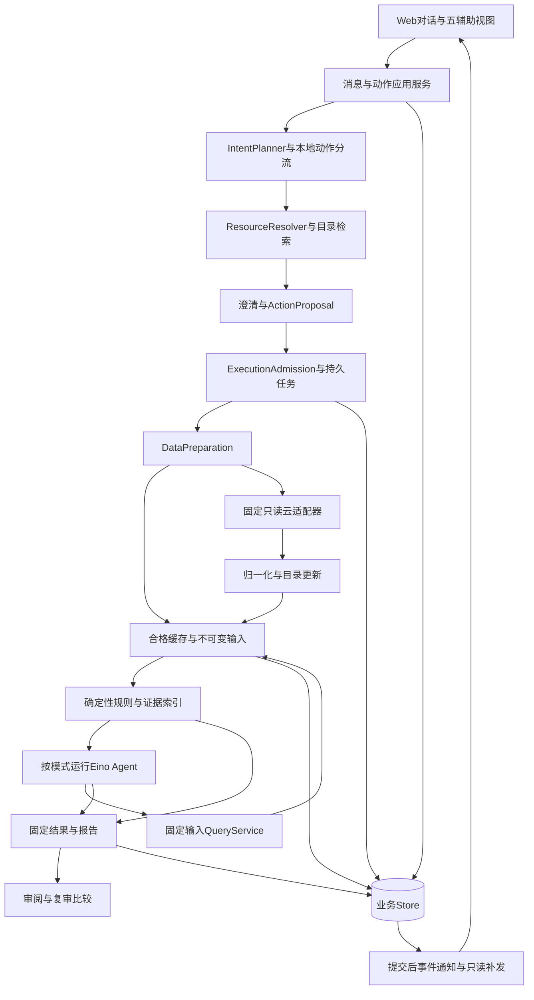

# 系统架构与总体设计

基线：需求v0.6／B2与整体设计v0.6已通过G1／G2。2026-10-30依据[PRD](../requirements/product.md)、[客户场景目录](../requirements/customer-journeys.json)修正产品主链及采集方案；本文区分现行契约、已落代码与实际验证，未验目标不写成通过。

现有正式工程已有固定输入规则、持久会话／确认、三槽位执行、Eino九工具、报告复审与显式只读适配切片。证据分别见[E1](../validation/evidence/e1-local.md)、[E2](../validation/evidence/e2-local.md)、[E3](../validation/evidence/e3-local.md)、[E4](../validation/evidence/e4-adapters-local.md)。正式Go／Vue现已接无快照对话、来源隔离目录／消歧、同一audit内发现／采集与晚封存、M0合格复用、结构化元数据／安全组、共用业务草稿、可信归属、串行分批及显式模型环境配置承接。限定代码／浏览器证据见[当前记录](../validation/evidence/conversation-implementation-local.md)，剩余项见[实现差异台账](../development/implementation-gap.md)。24旅程／88分支的完整M0尚未验收；真实云、上游模型连续兼容、正式评价和真实人工整改仍未验。原型仍只证明人工情境的交互效果。

## 1. 产品目标与技术边界

用户从空白对话表达目标，系统在有限范围定位对象、准备资料、做确定性检查与Agent补充、保存固定结果；用户确认业务资料并在云平台手动整改后再复审。正常对话不要求配置每台资产、逐个API批准或按后台阶段手动推进。

首版单操作者、单显式阿里云账号；互联网入向、有限出向、单NAT网关ACL。每个审计任务仍只含一个规范策略分区；同会话多个边界分别形成关联任务／报告，不构造端到端网络矩阵。20台业务组是有限正常对象集，目录数量、单批处理量、3会话并发与真实案例复用1台ECS分别计量。完整SNAT／DNAT、云安全中心／客户端、扫描、云写、多云、多Agent产品、微服务与通用知识平台均排除。

事实自动读取，业务角色／访问要求／必要性／例外由用户分项确认。名称、标签、安全组和流量只作线索；规则事实、候选、待确认、信息不足、不支持与执行终态分开。配置允许不等实际可达，报告不承诺完整合规。

## 2. 主要技术选择

| 决策 | 采用方案 | 取舍与实现边界 |
| --- | --- | --- |
| 后端 | 单Go进程＋Gin，类型化应用服务 | 复用现有模块；HTTP handler不执行长事务、不保留Gin Context给工作器 |
| Agent | Eino v0.9.22及已锁模型组件，每任务独立Runner／工具闭包 | 复用固定证据Query层；不把目录发现、云API或确认权限交给模型自由循环 |
| 前端 | Vue／TS／Vite／Router＋Nuxt UI v4／Tailwind v4 | 对话主入口＋五辅助视图；无Nuxt服务端、AI SDK后端或第二组件体系 |
| 持久化 | 纯Go SQLite／modernc＋GORM，WAL普通连接池 | 短事务、唯一约束、显式迁移与普通备份恢复；不自研写队列、读写分池或checkpoint调度 |
| 执行 | 持久任务表＋3槽位，同会话1个未结束任务 | 第4个排队；各任务输入／取消／模型上下文独立，共享准入与持久用量 |
| 数据准备 | 按需首次刷新＋合格不可变缓存＋规则预处理 | M0必需；可选定时仅采集、默认关闭；不把预取原文直接全量送模型 |
| 模型 | 保持既有MiniMax配置，首适配非流式Chat Completions | 保留512等更严私限；事件SSE不等于模型token流；配置启用／上游验证／本次使用分别处理 |
| 部署 | Go可同源提供已构建Web，默认loopback＋应用访问头 | 私有原文、数据库、配置不挂静态根；公网发布/TLS不是当前已验收部署 |
| 历史 | 业务Store保存可见消息、确认、任务／证据／报告，Eino执行状态独立 | 不持久reasoning，不重放旧wire或孤立tool消息；重启不恢复外部调用 |
| 接口文档 | 固定Swag从实际Go注释／DTO生成JSON／YAML，SSE另有schema | [实际规范](../api/README.md)只记已注册API，不先伪造目标接口产物 |

配置现支持互斥的显式模型JSON／`--env-file`，独立云JSON与`--execution-config`；来源、空值优先、持久授权追加和静态Provider边界统一见[凭据与配置](credentials-and-permissions.md)。启动、检查、本地目录、引导和计划预览零外呼；凭据存在不产生新的执行额度。直接在main推进，不自动提交／推送。

## 3. 业务呈现与内部编排分开

客户看到“找对对象→核对计划→自动检查→看结论→补资料／人工处理→复审”。内部把它拆成不同责任；两者没有一一对应的步骤按钮。

| 组件 | 输入／产物 | 责任与限制 |
| --- | --- | --- |
| MessageRouter／IntentPlanner | 原话、同会话结构化上下文→有限意图修订 | 状态、取消、导航优先本地路由；含糊目标可用获准模型解析，模型不能决定权限或提供RPC |
| ResourceResolver | 类型化选择器＋目录覆盖→唯一对象或少量候选／缺项 | 稳定ID核身份；同名／指代不清先问。新显式ID不应继承冲突的旧地域过滤；客户归属须有来源 |
| Proposal／Confirmation应用服务 | 对象／效果预览、业务差异→接受事件 | 执行确认与角色／访问／例外确认分别绑定；修改对象、服务、方向或基版使不兼容预览失效 |
| DataPreparation | 已接受计划→数据计划、目录或固定manifest | 先资格检查，再必要读取／完整性核验；不排自己的子任务等待；不让模型从工具临时刷新 |
| Collector／Normalizer | 白名单操作→元数据、SG、保护、ACL、引用及族时点 | 批量、去重、完整分页、最多两轮观察；外部名称／标签只是数据 |
| RuleKernel | 固定manifest→确定性结果、证据、可比较集合 | 本地预计算可支持事实；原始规则结果不被模型覆盖 |
| Agent／QueryService | 获准投影、规则结果→有界补查、候选与条件建议 | 先概要后按需查询；范围、证据依赖、轮次、时间、输出均由服务端校验 |
| Report／Review／Recheck | 固定结果、人工处理、新资料→固定报告与比较 | 待办不等修复；旧报告不跟最新资料改变；缺对象或不可比条件单列 |

业务上下文按对象／服务／分区／方向／确认版本匹配，不能把某台机器的管理白名单带给整个业务组，或把入向来源当出向目标。资料缺失可以结束本次任务并留下待确认，再用新版本新建关联审计，不长期占槽等待用户。

## 4. 采集方案与20资产取舍

接口字段、分页、RAM及公式的唯一依据为[采集工作负载研究](../research/collection-workload.md)，适配细节在[云采集](aliyun-collector.md)。ECS目录负责名称／标签定位；CFW资产接口主要支持IP／实例ID，不伪造名称／标签搜索。控制面RegionNo、ECS地域与返回资产地域分开。NAT防火墙列表只代表CFW已纳入网关；列全部VPC网关须另明确接入VPC只读操作。

采用按需与缓存混合方案，而非每轮实时全拉或先造一套后台调度平台：

1. 无合格资料或用户明确已改动时，任务自身进行有限刷新；发现只取定位元数据，明确对象后才取完整策略／关联证据。
2. ECS在同地域按已选ID分批，遵守官方最多100 ID及真实分页；安全组按账号／地域／组ID去重。ACL按所选方向／网关每轮完整取一次供对象共用，引用按身份去重。
3. 获准CFW切片可以一次枚举后本地关联；若只准逐ID读则保留逐ID，不为减少次数扩大读取范围。
4. 首版只共享已经提交的合格不可变资料，不合并进行中的刷新。相同资料在多个会话同时冷启动可能重复读取，计入共享预算；这是小规模实现取舍，不引入跨任务取消与订阅者授权合并。
5. 本地归一化后建立对象／策略／引用索引，规则先计算事实。模型只收概要和受控证据，不重复吞整账号原文。可选定时采集后续开启时沿用同一Collector／缓存资格和准入，不自动审计或调模型。

20台同地域、4个共享SG、80条ACL、项目页50、3个静态引用、两轮、身份1次的**人工算例**：

| 路线 | 请求数 | 选择依据 |
| --- | --- | --- |
| 原逐台ECS／CFW且共享SG重复读 | 131 | 历史调用结构的人工算例，不再描述当前实现 |
| 批量ECS＋SG去重、CFW仍逐ID | 61 | 当前基础路线；20人工资产签名loopback亦记录61次物理尝试，不等真实云耗时／权限验收 |
| 再复用获准的一页CFW切片 | 23 | 仅当该切片已在接受读取范围内且实际一页，不能普遍承诺 |
| 同20台、改为20个不同SG | 55 | 以切片方案计；组分布改变成本 |
| 同4组、1000条ACL及12引用 | 77 | 以切片方案计；策略／引用量可主导成本 |

发现、重试、凭据交换、更多页和地域另加；资产数不等策略数或模型轮次。两轮相同只表示observed_stable，不是原子云快照。公开文档无法给出本账号RTT，当前不能声称20台实际N秒；若仅对61次串行请求代入人工0.1／0.3／1秒，网络项为6.1／18.3／61秒，未含排队、退避、规则、模型或持久化。有限并行受依赖和两轮屏障约束，不能用总数直接除以3。

## 5. 数据时效、预处理与模型等待

当前M0按完整已提交snapshot及所选绑定检查缓存资格，核对账号／范围版本、分区／方向／网关、对象与关联覆盖、族完整性、采集窗口、引用闭合、schema／适配／normalizer／语义版本及已知变更。任意数据族混拼、只刷新必要族和inflight合并未作为当前能力交付。新建snapshot不让旧section续鲜；权限收紧或用户声明变更使相关缓存不合格。云资料复用不等于旧规则或业务结果复用，规则／业务版本不同须重新计算。

| 客户意图 | 内部处理 | 用户可见效果 |
| --- | --- | --- |
| 解释选定旧报告 | 固定旧输入；本地说明或获准模型解释 | 原时点与限制；零新增云读取 |
| 核查现在，允许合格复用 | 执行前再核资格，不合格才刷新 | 说明实际使用的各族时间；当前不等每次强刷 |
| 刚人工改完／明确刷新 | 设置fresh_after与force_refresh，必要族取新资料 | 刷新失败保留旧报告，不能以旧资料称本次已修复 |
| 云采集慢／部分失败 | 阶段事件、已得资料与影响范围；保留可证实事实 | 可等待、返回后查看或取消；不要求点击推进每一阶段 |
| 模型慢／无效／失败 | 已持久L2先可看；保留规则与缺项，Agent阶段标失败／不足 | rules_only不因模型未启用变partial；选择Agent而未完成时partial |

前台显示对象、已用时间、当前阶段、已得结果与下一步，不展示伪百分比、内部reasoning或大块原始事件。后台记录分阶段耗时、页数、缓存、实际尝试、终态、token已知／未知用于后续校准。非流式模型的连接／响应头／完整响应、逻辑轮次与重试需分开配置；统一限制见[会话执行](session-and-execution.md)，不凭30秒或4／6次推导可用体验。

合法但不完整的采集资料可保存支持独立事实的partial输入；身份、范围或协议不安全时不勉强封存，安全的已读观察可单独保存为未就绪云记录。取消已生效后的迟到响应不能新建快照／封存输入，既有已提交证据保留。复审的improved仅表示严格可比时违规集合为旧真子集，原始fail仍保留；原评估时点与新采集时间分开，不等真实整改或运行时恢复。

## 6. Eino函数工具与MCP取舍

当前选同进程Eino类型化函数工具：已有Runner和九工具可复用，单Go／Web／3会话无需增加连接器进程。工具使用固定schema、任务输入、证据引用与QueryService，不能让“函数工具”绕过授权。真正的依赖补查是先读规则引用再查对应静态对象，下一轮才可引用返回证据，不是把同批工具伪装成依赖。

| 选项 | 收益 | 成本与结论 |
| --- | --- | --- |
| 内置函数工具 | 简单调用、复用已有应用查询与取消／账本 | 仍需范围／输入／输出校验；首版采用 |
| 现成MCP客户端适配可信外部工具 | 需要外部复用时可接互操作协议 | 增加身份、工具发现、传输和故障；有真实需求再接，不是当前前置条件 |
| 自建MCP server再由本应用回调 | 可服务多个外部客户端 | 当前无跨客户端需求证据；增加协议／生命周期／鉴权／兼容工作，暂不采用 |

MCP不减少云分页，不替代云RAM、模型编排、证据正确性或业务权限，也不自动带来更安全工具。未来确需对外服务，可在稳定QueryService外包装协议，保持一套领域逻辑。官方Eino／MCP版本差异与来源见研究§7，不把不同版本规范拼成已兼容实现。

## 7. 并发、存储与恢复

持久jobs是事实源，内存通知仅唤醒；3个不同会话真实并进，同会话1个queued／running／cancelling任务，第4个排队，队列沿用10个待执行的当前保护值。一个审计任务自身完成准备／规则／Agent，不排子collect再等待。分批仅按已接受同分区批次顺序执行，各批保留独立输入和覆盖；不能截前N宣称整体完成。不同分区另建关联任务。父分批只占一个槽位，内部子段串行执行而不另排队等待；各段保存独立输入、来源时点、审计及报告，父级只汇总covered／failed／unprocessed，不生成代表全组的合并Audit／Report。取消父请求保留已得证据并停止新增段。

云／凭据HTTP沿用全应用并发2，模型3且每任务1；这不是三倍授权。每次物理尝试先在短事务按任务／会话／应用更严上限预记，提交后才发送；失败和送达未知也计数，存储不可写停止新增外呼。取消只影响本任务；已发上游不能保证撤回费用。任务根deadline覆盖排队和执行，不随SSE或重连续期。

SQLite使用本地WAL普通sql.DB／GORM池，外键与合理锁等待，及时关Rows；不在云／模型／SSE等待中持事务。纯Go构建、独占进程锁、显式schema迁移、普通备份恢复保留；无AutoMigrate、全局写锁、强制单写池或自研checkpoint调度。重启取得独占锁后把运行任务标interrupted，不重放外部请求。当前business schema 5纳入规划／目录、准备绑定、业务草稿、归属、分批及授权修订；旧版和缺必要结构的库拒启，须显式迁移。

业务草稿冲突现有同稿恢复：先只读核对当前稿和业务head，保留原输入，字段默认不选；用户选择后才更新／重绑定并重新预览，不确认任何部分。草稿revision与当前heads双CAS，原body/key回执可重放；旧回执不冒充当前更高修订。schema 5必要结构包含profile_draft_rebase_requests，缺表库仍须显式迁移，不能正常启动补表。

fetch SSE使用应用访问头，seq持久、提交后发送、只读补发；断线只停止观察，不取消、不重建任务或重置额度。完整协议见[前端与事件](frontend-and-events.md)。

## 8. 工程依赖与交付顺序

入口／适配器依赖应用与领域；领域不依赖Gin、Eino、SQL或云SDK。Web DTO、云DTO与规范领域类型分别维护。现有工程结构可继续复用，不建空目录充功能；私有原文独立忽略路径存储，公开人工fixture标synthetic。

按[实施计划](../development/implementation-plan.md)先确认客户旅程及原型，再落实目录／规划／业务草稿与配置承接、数据资格／批量采集／结构化材料、正式Web主链，最后真实只读／人工整改／正式评价。完整差异见台账，不把文档或原型计为生产实现。

NFR-06既有本地验收目标保留：Linux／WSL x86-64，2逻辑CPU／4GiB、本地SQLite；预热100次GET及20次小写P95≤1秒；1资产／100策略／≤1000计算单元规则≤5秒；10资产／200策略／≤10000单元规则≤20秒；后端峰值RSS目标≤512MiB。均为已批准的本地验收条件／目标，尚非本轮实测，不含云或模型延迟，不要求购买实例，不因本轮整改自动改阈值。

验证包括最终J分支集、空白对话到复审、三会话真实重叠、范围隔离、完整性、冷热缓存、慢云／模型、取消／断线／未知受理、保存冲突及接口产物。20资产请求量fixture与时间敏感性不代替真实性能；20～30独立案例的规则／固定模型／Agent同条件评价、上游连续兼容和至少一次真实人工整改复审仍分别实际取证，见[验证计划](../validation/verification-plan.md)与[评价计划](../validation/evaluation-plan.md)。

## 9. 整体对照后的呈现取舍

以下约束可通过呈现与编排满足既有M0，不需要删减已确认的业务条款；正式实现仍按完整场景验收。

| 技术条件 | 采用的客户呈现 | 保留的业务保证 |
| --- | --- | --- |
| 不同方向／网关没有统一首匹配顺序，也不做端到端矩阵 | 一次计划一个分区，同会话关联多个报告 | 边界清楚，证据和复审不混用 |
| 对象集合超过可执行单批／剩余额度 | 显示完整匹配覆盖，可收窄或接受同分区分批，汇总未完成项 | 不截前N宣称全量，不把未处理当通过 |
| 云API分页、限流和模型时延未知 | 阶段、已用时间、已得规则、取消及返回后查看；不报无依据完成百分比／精确剩余秒数 | 长等待不隐藏事实，失败和部分结果可审阅 |
| 资料／模型不能证明全部事实 | 显示具体缺项、未知或不支持，用户可保留未知先做独立基线 | 不迫使用户补技术原文，不编业务授权 |
| 首版不做跨任务刷新合并 | 复用已提交合格缓存；并行冷刷各自执行并计共享额度 | 会话／取消隔离，缓存原时点和读取范围真实 |
| 首版不长期挂起任务等业务答复 | 本次给待确认及固定报告，用户分项确认后新建关联审计 | 不占槽无限等人，不改旧结论，连续会话仍可接续 |
| 原型为有限人工状态机且无磁盘 | 显示模拟来源、内存限制；用重开人工历史／中断情境观察恢复表现 | 能评审使用效果，不能计作正式持久／SSE／云／模型验收 |

本轮已完成若干正式Go／Vue代码切片与限定离线／浏览器验证，仍不能据此将完整客户主链或88分支标为通过。后续代码以[实现台账](../development/implementation-gap.md)逐项关闭；不能把这些呈现取舍用于豁免服务级授权绑定、完整性或历史对象一致性。
