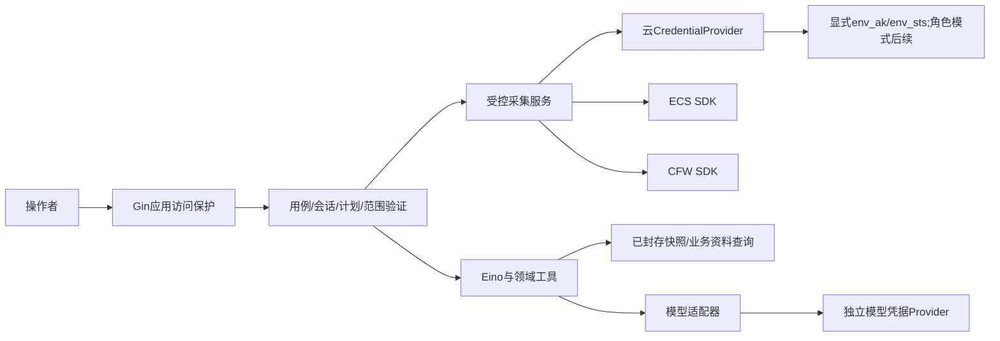

# 凭据、权限与外呼准入设计

基线：需求v0.6／B2、设计v0.6，G1／G2已通过。本文为该领域的现行详细设计；实际运行验收另行取证。

2026-10-30正式代码已接显式`--env-file`／模型JSON互斥、统一`--execution-config`工作负载、同Ref追加授权修订与可选到期；连接权限上界与来源限定业务目录分开。以下区分已落地代码、具体接口和仍待真实验证的保证；当前证据与剩余项见[代码记录](../validation/evidence/conversation-implementation-local.md)及[实现台账](../development/implementation-gap.md)。静态Provider、上游未验证和完整M0未验边界保留。

## 1. 四种身份不能混为一个 token

| 层 | 证明／允许什么 | 配置位置与边界 |
| --- | --- | --- |
| 应用访问 | 操作者是否能读本地历史、建任务、确认资料和导出 | 最小本地访问口令／同源控制；不是云密钥，不形成组织账号系统 |
| 云连接身份 | 该连接以哪个 RAM 用户／角色调用哪些云服务 | 服务端 CredentialProvider；CFW 与 ECS 可共享一个明确的凭据来源，但各自权限均需具备 |
| 模型身份 | 已配置模型服务的API访问 | 显式JSON或显式`--env-file`兼容模式二选一。凭据来源明确，不借云AccessKey、不自动读dotenv或机器profile |
| 工具执行授权 | 此次会话／任务允许读哪些资产、引用、数据字段、调用多少次 | 服务端专用 ToolRegistry＋范围／预算；模型不接收凭据，也不能提升权限 |

MCP 若未来出现，是第五个“连接到工具服务器”的认证边界，不替代云身份、应用身份或工具权限。

## 2. 依赖注入：凭据不经模型传递

启动时组装接口：采集服务持有 CloudClientFactory／CredentialProvider，模型适配器持有 ModelCredentialProvider，Agent 工具仅持有领域 QueryService 与包含 policy_scope_ref 的授权上下文。云 SDK、私有配置和 raw token 不作为工具参数，也不放聊天／系统提示词／可序列化 Eino state。

Gin 的 request context 仅用于本次 API 的认证、验证和短事务。异步任务复制已验证的 operator／workspace／connection／scope 引用和预算，由服务根 context＋任务 deadline 驱动；不得保留池化 Gin Context，也不能因返回 202 就把后台工作取消。

## 3. 云平台与云防火墙的统一连接

同一`cloud_connection_id`描述认证来源、账号期望值、受支持API、管理员读取权限上界、配置版本及脱敏就绪状态。它不应承载全量业务资产目录；名称／ID／类型／地域及本次目标由会话意图、资源目录与已接受计划确定。当前allowed_assets／allowed_nat_gateways已作为可选额外收紧条件，来源限定业务目录独立持久化，不能以空名单隐式扫描账号，见[采集设计](aliyun-collector.md)。ECS、CFW、必要 VPC 客户端注入同一明确凭据 Provider，再由各 SDK 为相应服务签名；不要求每个产品在对话里分别输入 AK。

但共享身份不等于共享全部权限：RAM 需要覆盖各产品相应读取动作，应用还要限制该任务真正需要的操作和对象。身份验证成功不代表账号开通了 CFW，也不代表 API 分页／字段／保护范围完整。

### 3.1 最小业务动作映射

以下动作名依据已保存官方资料的授权段落；不是已经下发的 RAM 策略，不自动创建 RAM 用户／角色或授权。资源级限制与条件是否支持以各接口授权页为准，不能从SDK包名猜RAM namespace。名称／标签须先经ECS目录解析，再用稳定身份关联CFW保护视图；CFW的SearchItem不提供名称／标签目录，NAT防火墙目录不代表账号全部NAT网关。当前接口条件与请求量依据见[采集研究](../research/collection-workload.md)。

| 数据 | 只读业务 API | 官方动作／处理 |
| --- | --- | --- |
| CFW 资产 | DescribeAssetList | `yundun-cloudfirewall:DescribeAssetList` |
| CFW 互联网 ACL | DescribeControlPolicy | `yundun-cloudfirewall:DescribeControlPolicy` |
| NAT 网关／防火墙元数据 | DescribeNatFirewallList | `yundun-cloudfirewall:DescribeNatFirewallList`（T-02） |
| NAT 边界 ACL | DescribeNatFirewallControlPolicy | `yundun-cloudfirewall:DescribeNatFirewallControlPolicy`（T-01） |
| 静态引用 | DescribeAddressBook | `yundun-cloudfirewall:DescribeAddressBook` |
| ECS 上下文 | DescribeInstances | `ecs:DescribeInstances` |
| 安全组上下文 | DescribeSecurityGroupAttribute | `ecs:DescribeSecurityGroupAttribute` |
| 必要网卡／EIP | 相应 Describe 查询 | 仅范围确需时添加并按 A-27／A-13 核对授权，不默认整个 VPC 读权限 |
| 当前调用身份 | GetCallerIdentity | 仅明确的连接检查／首次受控采集时核对账号与身份；A-30 暂无授权信息透出，不编造其最小 IAM 条文 |

某些列表查询为完整性需要读取账号相关策略分区；必须在采集前展示这一读取范围。RAM 资源粒度不足时，应用范围和模型投影仍限制用途，但不能反称 RAM 已实现每台资产级隔离。

## 4. CredentialProvider 模式与启动注入

A-28／A-29 提供官方 Go 凭据路线。**本应用默认显式选择连接模式，不无条件采用整台机器的默认凭据链**，不悄悄读 `~/.aliyun`、其他项目或公司环境身份后尝试调用。

| 模式 | 场景 | 自动续期／前提 |
| --- | --- | --- |
| `env_sts`／私有临时配置 | 当前E4已接：操作者显式JSON点名同一记录的STS三元组环境变量 | 静态Provider；可检查已知到期但不自动续期，过期需重新注入 |
| `env_ak`／私有 RAM AK | 当前E4已接：暂不具备短期凭据条件的明确低权限RAM身份 | 静态Provider；身份核对拒绝root，保护与轮换由操作者负责 |
| `assume_role` | 后续设计，当前配置不接受此模式 | 尚未实现角色取得／续期；未来仍须源身份与sts:AssumeRole授权，不自动提权 |
| `ecs_ram_role` | 后续设计，当前不访问实例元数据 | 尚未实现实例角色Provider；未来仍须显式启用，不把长期AK写镜像 |

默认链是 SDK 提供的能力，不是本应用自动获准使用的身份。若以后允许标准环境变量／配置 profile，也需操作者显式选定并绑定期望账号，不能凭缺少项目配置就回退到其他身份。

当前按显式连接复用静态CredentialProvider，不为工具取得另一身份；尚无远程STS换取／自动续期。客户端缓存与并发续期合并属于后续可续期模式的要求，不能说成已经实现。密钥／token 轮换不应破坏业务历史；新密钥仍需属于相同允许身份，账号／权限边界改变则重新校验并阻止越界任务。

## 5. 配置契约、状态与持久授权修订

### 5.1 当前实际实现

模型入口为互斥的显式`--model-config` JSON或`--env-file`；云仍只读显式`--cloud-config`及其中点名的进程环境变量，不搜索dotenv、实验私配或机器profile。云仅静态env_ak／env_sts，生产端点受控。`--config-check`输出本地脱敏摘要，不开业务库、不取STS、不查身份或网络，ledger_state为not_checked。disabled、凭据本地不齐／到期、授权到期或未绑定与结构错误分开；适配器不可执行不阻断历史和离线规则。

字段和参数以[后端README](../../server/README.md)、[modelconfig](../../server/internal/modelconfig/config.go)、[cloudconfig](../../server/internal/cloudconfig/config.go)与[workload](../../server/internal/workload/config.go)为准。[e0.sh](../../scripts/e0.sh)透传显式参数，并按调用者目录解析相对路径。统一限制已贯通计划、Store、Engine、Runner、Collector和物理HTTP；更大显式profile可生效，原30秒／4或6次／100次／90秒仅为标注legacy的未校准兼容值，私限与显式0仍取严，见[会话§6](session-and-execution.md)。

| 当前实际项 | 行为边界 |
| --- | --- |
| `CFW_APP_TOKEN` | 本机应用口令，与云／模型凭据分开，仅访问头发送 |
| `--model-config`、`api_key_env` | JSON指定模型、HTTPS命名空间、协议及密钥变量；不自动继承CFW_MODEL或换模型 |
| `--cloud-config`、`credential_mode` | JSON指定同一env_ak或env_sts凭据记录、期望账号、有限静态地域／对象／网关 |
| `credential_expires_at` | 静态STS已知到期可标记；未知仍unknown，refreshable=false |
| `budget.ref`／可选`expires_at`／次数 | 同周期持久取严；已有到期不因缺字段消失，云／模型同时启用Ref一致，显式0保持0 |
| `--env-file` | 仅显式文件的七个模型字段；进程LookupEnv存在即优先，含显式空，不与模型JSON拼接 |
| `--execution-config` | 四类完整服务端profile、可选共享预算与数据时效政策；客户端／模型不选择更宽profile |
| `--budget-change` | 本地管理员显式追加同Ref修订后退出；基修订CAS／change_id幂等，不清旧attempt |
| `collection-options` | 本地配置目录，identity_verified=false；GET不验证身份或产品 |

### 5.2 显式配置来源与既有CFW_MODEL兼容

模型来源二选一：`--model-config <json>`，或`--env-file <file>`。后者是已实现的显式兼容入口，不自动寻找`.env.local`，不shell source文件，不执行命令／变量展开，不搜索其他项目、默认profile或公司环境身份。显式环境文件不存在／格式错误不向其他来源回退。独立云配置`--cloud-config`可与任一模型来源并用，但模型的环境文件模式与模型JSON同时出现时明确拒绝，不按字段拼接。

环境模式仅读取既有白名单字段，其他服务字段不载入内存配置；未知`CFW_MODEL_`键、重复键、结构字段大小写冲突、控制字符或不合法引号返回受控错误。该文件先受普通文件／大小界限约束，解析器只按字面量处理。每个字段先查进程`LookupEnv`：**只要明确存在就优先，包括空值**；进程不存在才取选定文件的值，二者都未提供时只可使用该字段明确允许的缺省；兼容模式的超时、调用数和输出数值必须显式提供。显式空值不是未提供：必需字段空则该来源无效，数值空则报错，不偷偷回填文件或更宽默认值。

| 兼容字段 | 归一化语义 |
| --- | --- |
| `CFW_MODEL_BASE_URL`／`CFW_MODEL_NAME` | 保留既有模型与服务命名空间，不自动换MiniMax模型、补私有端点或移除必要路径；实际endpoint由受控适配器形成 |
| `CFW_MODEL_API_KEY` | 只作为该模型记录的密钥，不进摘要、业务库、模型消息、错误、Git或公开导出 |
| `CFW_MODEL_API_STYLE` | 保留显式协议；首版可执行chat_completions。已知但未实现的responses标能力不支持，不静默回退协议；未知值属结构错误 |
| `CFW_MODEL_TIMEOUT_SECONDS` | 单次完整响应保护，进入统一effective profile取更严；不是任务总时限或供应商SLA |
| `CFW_MODEL_MAX_CALLS` | 保留原更严的单任务模型调用约束，逻辑轮次／物理尝试分别计数；物理重试不能使实际发送绕过该保护，不把它解释为新会话／应用金额授权 |
| `CFW_MODEL_MAX_OUTPUT_TOKENS` | 保留操作者显式上限及原512等更严限制；缺省由版本化profile给出，不为通过测试自动提高 |

兼容模式统一产出与JSON相同的类型化ModelSettings、来源引用、字段存在标记和版本，再交给同一Factory／执行保护；不维护两套调用语义。JSON模式的模型元数据只来自所选JSON，密钥只来自其点名进程变量；进程中其他CFW_MODEL字段不混入JSON元数据。模式选择存在不代表本次执行授权，环境文件七字段也不凭空生成新的累计额度；已有持久授权及更严限制原样承接，缺执行策略时保持本地可用／外部执行阻断状态。

云凭据以同一显式记录为原子单位选择：AK ID／secret／STS token与模式、期望账号一致；任一缺失不从模型文件、其他账号或机器profile补齐。环境兼容入口首版只承接模型，不能由此扩展云默认链。模型、云和应用凭据相互隔离。

启动脚本与config-check共用来源解析器，正式参数原样传递，显式相对路径按调用者目录处理。启动／配置检查零DNS、零HTTP，不初始化会急切取凭据的客户端，不让配置检查隐式启用工作器。`.env.example`保持公开占位说明，不读或打印用户私配、密钥片段、私有URL或其哈希。

### 5.3 本地检查、执行检查与上游验证分层

| 状态层 | 含义与处理 |
| --- | --- |
| `source_selected`／`structure_valid` | 来源明确、格式／模式／字段结构一致；来源冲突或畸形是配置错误，不自动换来源 |
| `enabled` | 是否启用此适配器；disabled仍检查非敏感结构，但不读取密钥、不因历史授权已到期误判结构非法；不启动外呼 |
| `credential_local_ready`／`credential_expiry_known`／`refreshable` | 启用后仅核点名记录是否本地齐备、已知静态到期及是否有明确可续期Provider；本地齐备不证明云身份／模型认证成功 |
| `execution_policy_ready`／`authorization_state` | 任务保护存在，当前类别获准且可选累计授权有效；到期、禁用、额度耗尽或缺策略停止相关新外呼，仍可读取历史与离线规则 |
| `ledger_state` | `not_checked`、兼容、旧版／不兼容、不可写；config-check不打开库时必须not_checked。正常启动须按持久Store契约检查，账本不可写不得发送；不能用config-check通过代替 |
| `identity_verified`／`product_ready`／`upstream_validation` | 保存明确执行的身份、产品或模型验证结果及来源／时点。状态GET不在线刷新；configured／enabled不等已验证。模型已配置启用且本次明确选择，可在授权内尝试，未验证只是保证级别 |

本地结构检查、disabled、静态凭据到期、累计授权到期和账本就绪必须分别返回受控类别；不能压成一个configured布尔值。结构错误不创建部分Provider；某个适配器disabled／过期／未获准不应误伤离线规则与历史，但业务库本身不可用仍按存储失败处理。启用且凭据不齐保持该适配器blocked，不搜索其他身份；需外呼的计划不能接受，客户可修配置或改离线路径。

执行前由统一准入核当前账号期望、范围、最新授权修订和凭据状态；实际云请求先GetCallerIdentity，拒绝root／账号与受支持IdentityType／ARN冲突。当前connection_check只有IDENTITY_ONLY partial，product_ready=false；目标产品读取按固定操作分别报告权限、字段和分页能力，身份成功不证明全部产品权限。模型的真实多轮兼容和输出质量也需独立记录，状态展示不会触发测试请求。

独立身份核对使用identity_only，保留明确source／scope／conversation，但不要求预列资产或选择网关；asset_ids／gateway_ref须空。它只允许GetCallerIdentity，不读取产品或生成审计快照，不能解释为账号全部权限通过。前端只核有限输入／目录归属，不能用旧100次／50资产／6次常量否定服务端更大显式profile；更严私限、显式0及服务端准入继续生效。

### 5.4 工作负载保护与授权范围

服务端统一WorkloadProfile描述有限的任务根期限、阶段期限、单次完整响应／连接／TLS／响应头保护、逻辑模型轮次、物理云／凭据／模型尝试、工具总数／单批、并发及输出大小。计划预览、Store准入、worker、Runner、Collector和HTTP共用同一解析结果，不再各包散放30秒／4或6次／100次／90秒永久假定。Profile是应用工程配置，不是机器凭据profile，客户端或模型不能自选更宽值。具体字段与deadline关系见[会话§6](session-and-execution.md)，原模型与更严私配始终优先。

任务deadline、模型单次timeout、可选累计授权到期和静态STS credential_expires_at相互独立。新物理发送须同时满足任务活动、阶段／单次剩余时间、当前授权、可写账本及有效凭据；每次含SDK重试／身份／未来续期都预记。任务、应用、会话、连接政策和当前授权修订分层取最严；明确0保持0，缺字段才可采用受控缺省，不允许0触发更宽默认。

累计授权可显式选择持续或有到期，已有授权若设置到期则必须保留，不能因新模式省去日期而变成永久。到期只停止新的相关请求，已送达者不保证撤回，不清账、不自动重放。每次正常客户执行只确认范围、资料和模式，不能要求逐请求填写额度或绝对日期。

### 5.5 append授权修订与分阶段启用

business schema 5已在同一稳定`budget_ref`保存不可变budget_policy_revisions及当前head，旧outbound_attempt记录不动；显式迁移将原政策保存为首修订。普通启动只初始化或收紧，不自动追加额度／续期，也不能换Ref清零绕过。本地`--budget-change`读取显式变更JSON，校验既有账本并追加后退出，与启动／migrate／config-check互斥，需先停止持库锁服务；这是管理员操作，没有虚构成Web付费授权接口。

| 修订信息 | 约束 |
| --- | --- |
| `budget_ref`、`revision`、`expected_base_revision` | 固定账本身份、单调修订、条件竞争校验；修订不创建新消费周期、不重算旧用量 |
| `change_id`与规范化请求摘要 | 同一明确变更的幂等键；重复同正文返回原修订，同键不同正文冲突；只含非敏感政策字段，不引入批准原文快照机制 |
| `actor_ref`、`reason`、`authorization_ref`、`created_at` | 有来源的操作者／授权依据及时间，来源不可由模型自证；不存凭据或私有URL |
| 类别启用、应用／会话累计总上限及可选到期 | 保存变更前后允许状态；追加量转换为明确累计总上限，0不自动当缺省，不能借续期清已用量 |
| 生效范围与profile／配置绑定 | 只改变明确类别和范围，不切账号／扩云权限；已接受任务有冻结上限，增加额度不自动给旧任务补额 |

先启云再启模型：首修订的模型类别为0／未启用，操作者明确追加模型类别和累计总量后写新修订，再启用模型适配；云attempt保留。先模型后云同理。若当前仍有独立JSON字段明确限制模型为0，追加必须显式同步该限制或迁移到共用策略绑定；未修改的更严0继续生效，不能静默覆盖。两配置同时启用仍引用同一budget_ref和可解释的当前修订，不能各维护不相容累计政策。

追加／续期只有明确授权变更可提高对应上限或延长到期，模型、普通任务提交或密钥轮换不能发起。普通更换密钥只改变凭据引用，不改变账本；原尝试含unknown仍累计。续期同Ref、保留所有已用量；收紧可低于已用量，此时该类别无新增额度但历史不删；禁用即停止新发送。并发修订按expected_base_revision竞争，失败重新核对，不覆盖较新修订。

原子变更在短事务内校验操作者来源、基修订和幂等，追加revision、更新head并保存可见状态；不跨网络等待。新计划绑定当前修订与effective limits。运行前／每物理发送再取当前head更严约束：追加不扩大原计划、收紧／到期／禁用即时关闸，配置身份变化令旧计划失效。账本不可写或迁移未完成时外呼失败，不因未记成功就请求供应商。

### 5.6 配置与修订验收

使用公开假值覆盖：原CFW_MODEL文件→显式兼容模式、逐字段进程存在／不存在／显式空、缺文件、重复／大小写冲突、JSON与环境双选、enabled／disabled、disabled且旧授权到期、启用凭据不齐、静态STS到期、仅云／仅模型及先后追加、续期／收紧／禁用、0额度、并发修订、同键重试与不同正文冲突、账本旧版／不可写、相对路径及空格路径。保留原模型／512等私限而不读取真实私配；断言启动／检查0外呼、无敏感值日志或落库，区分本地结构通过、账本未检查及上游未验证。

## 6. 续期、时延与错误

静态 STS 过期时不能声称 SDK 总会自动续期；只有角色等 Provider 有明确可续期来源才成立。取得凭据、身份检查、刷新、API 请求和退避均计入采集阶段和根预算，不能只统计 Describe 接口网络耗时。

凭据库的缓存、刷新触发、内部超时／重试及 transport 注入要在固定版本中验证。给 GetCredential 外套一个协程超时并不证明底层调用停止；已发出的请求只能尽力中止，不保证撤回。当前静态Provider不做自动续期；未来明确可续期模式也不增加无限后台刷新，单次过期只允许受控刷新／重试，不重建整个审计来消耗新额度。

| 类别 | 行为 |
| --- | --- |
| 配置缺失／类型混搭 | 本地返回配置错误，不发外部请求，不要求在聊天贴密钥 |
| 静态 STS 到期 | 说明需操作者更新连接；原历史保留，不自动回长期 AK |
| 可续期角色凭据到期 | 在既定次数／剩余时限内请求 Provider 刷新，失败停止该阶段 |
| AssumeRole／API 被拒绝 | 返回权限类别与受影响阶段，不自动加权限或尝试全局身份 |
| 账号不符／主账号身份 | 拒绝继续业务采集，显示连接别名／错误类别，不在公开记录输出对方账号详情 |
| 限流／服务失败 | 共享限速、有限退避；记录真实尝试和累计时间，不多层重试叠加 |

应用默认接受被明确配置的 RAM 用户／AssumedRole 业务身份；上游角色源也应是低权限 RAM 身份，不能仅以最终角色身份验证就证明上游 AK 没有过高权限。系统不自动创建这些身份，操作者在实际接入时配置并验收。

## 7. MCP 的位置：可选受控连接器，不是认证捷径

首版的专用工具通过本地 QueryService 和官方 SDK 足够，不把外部 MCP 作为必需部署服务。MCP 不天然知道应使用哪个云账号，也不替代 RAM、SDK 签名或工具授权。

若以后确有可信外部 MCP 数据源：

- 只由后端管理员配置固定服务器／传输／工具白名单，默认关闭；模型不能任意输入服务器地址、加载工具或执行命令。
- HTTP 传输按服务器实际支持的授权及 X-01 规范处理 OAuth／资源绑定等，MCP token 只发给对应受众，不将云／模型 token 混传。
- stdio 的进程／环境注入和远程 OAuth 不同；若采用，仅显式允许必要字段，不继承全量环境，不由模型控制启动参数。
- 服务器工具的名单／版本、返回 schema、只读权限、范围、大小、超时和剩余预算仍由应用约束；远端声称只读不等于应用验证已通过。
- 云 AK 不因对方是 MCP 就交给第三方；远端如何访问云资源、身份委托与信任边界需单独审核。工具结果仍是外部数据，不能改变系统指令。

这是后续扩展门槛，不是已接入 MCP／已实现 OAuth 或本方案付费请求授权。

## 8. G2 后验收

- 配置检查零外部请求；当前实验配置行为不被未来云 Provider 的急切初始化破坏。
- 模拟同一 RAM Provider 对 CFW／ECS 不同服务签名和白名单；无任意 write／RPC／endpoint 入口。
- 身份不符／静态 STS 过期／续期失败／产品未开通分别处理；不读机器其他 profile 或混搭凭据字段。
- 固定版本 Provider 在并发、过期与总时限中的请求次数／续期／取消行为可观察，不只测外层函数返回快。
- 会话、日志、GORM SQL 日志、错误、报告和 Eino state 不含原始凭据；公开导出不泄露身份细节。
- Gin 请求结束后排队任务仍按服务根 context 执行，取消／停机只终止后续已授权请求，不错误继承 HTTP 生命周期。

本节官方资料核对与当前E4人工HTTPfixture不等真实账号验证。显式云配置、静态Provider、身份先行与固定只读SDK适配已接入；当前切片与待验项见[E4适配记录](../validation/evidence/e4-adapters-local.md)，E3历史证据保持原边界。

## 9. B2 的最小授权与实现约束

- 连接配置提供单账号、allowed_boundaries／允许地域／固定只读动作的权限上界；对象／网关名单若配置仅额外收紧，不要求逐台预列全部资产。业务ResourceCatalog由有来源导入或已接受的有限发现形成，配置scope条目只是“已配置但未验证”。空目录不自动扫描账号，缺资料生成有限发现proposal并沿同一目标接受。
- NAT名称／ID先经有来源目录解析、必要消歧后固定一个获准NatGatewayId；默认不传跨账号 MemberUid，不从可见的其他成员账号推导授权。返回账号／网关归属不符或含义未核实时拒绝相关输入，不切换身份补查。
- 当前只读操作是 DescribeNatFirewallList 和 DescribeNatFirewallControlPolicy；不按猜测的 List／V2 名称推断新旧或回退。曾出现的无可靠依据“已废弃”断言已撤除。T-01～05 的来源与字段见 [云采集设计](aliyun-collector.md)。
- 官方 NAT 动作支持按 ACL 的 AclUuid 和防火墙的 ProxyId 描述资源范围，不能声称只能资源 `*`，也不能把查询参数 NatGatewayId 塞进这两个 ARN 标识。优先账号限定／已知资源范围；为全分区枚举需更宽模式时明确告知并实际验证，不伪称逐网关／资产隔离。禁止全动作 `*`、FullAccess 和任何写操作。
- SNAT／DNAT 首版仅使用已明确提供的关联上下文，默认不新增 VPC 转换表查询；确需增加最小只读补证时，在 G2 列出新 API、RAM、数据与预算后采用。
- 所核 CFW Go SDK 有 WithContext 并调用 CallApiWithCtx。正式适配必须使用任务根 context；公开源码不代表凭据库、ECS、重试或底层网络取消已全部验证。G2 后用模拟 HTTP 和可控凭据源观测实际尝试，不只测外层超时返回。
- 执行计划预览／范围目录／auth-status 均本地读取，不换 STS 或访问云服务。真正外呼只在显式执行且效果上限允许时发生。两轮复读与续期共用既有预算，不能借新边界多领额度。

对应验证：B2-02／09／15～17、AC-09／18。没有生成或下发 RAM 策略，没有读取实际云／模型配置或使用机器其他 profile。

## 10. 统一准入与传输门槛（RV4-04／06／09）

Web Handler 只能提交类型化意图给 ExecutionAdmission，不能直接取得 CloudClient 或 ModelClient。kind 对应效果由服务端定义，/jobs 的调用方不能覆盖计划里的 kind／scope／预算。模型生成的建议不是用户确认事件，不能自行进入执行队列。

本地目标／目录规划不持CloudClient；需要发现或刷新时进入客户已接受的类型化准备计划，可在同一audit目标范围内继续，不逐API确认。固定资料助手明确选择模型后只允许模型与本地QueryService，禁止隐式身份检查／STS／云刷新；历史已有解释可零模型读取。连接检查不具模型权限，当前仅身份检查；目标请求数引用统一effective profile，不把当前6次暂值写成永久产品限制或单个操作成功当全部权限通过。Provider 必须惰性取得凭据，不能因为组装客户端、读取状态或生成预览而触发续期。

已知的应用／云／模型凭据值不得进入消息、审阅意见的日志或模型投影；自由文本不宣称完全可自动脱敏。审阅意见默认属于本地私有记录，不因保存在同会话就全部发送给模型或导出公开报告。

CFW SDK WithContext 的存在仅是接口依据。E0 必须证明：实际 HTTP 可取消、SDK／凭据内部重试可在同一 attempt ledger 计数、响应在解码前有界、错误正文不会泄露。若固定版本不能提供这些控制点，该适配不能作为通过版本，需要调整适配或回到 G2，不用外层 goroutine 超时或事后截断掩盖缺口。

当前云单次响应2MiB、每分区1000策略等为未校准工程保护值，目标统一纳入effective workload profile并受全任务读取预算约束，不是厂商限额或已测容量。超限／截断产生 COLLECTION_PARTIAL／UPSTREAM_RESPONSE_TOO_LARGE，不把被截掉的匹配条件当 ANY。具体正常响应可用性在模拟和真实 fixture 中验收，未经确认不自动抬高。

所有请求在物理发送前预记，包含身份和续期，发送未知时保守占用；与[会话设计的逐物理请求预算](session-and-execution.md)一致。该设计不创建新 RAM 用户、开通产品、安装客户端或增加云写接口。

## 11. SSE访问保护

按 [前端与事件](frontend-and-events.md) 使用 fetch 响应流，不使用无法携带既定应用访问头的裸 EventSource，也不把口令拼进 URL。事件页、SSE、结果和报告共用应用访问／范围检查，认证必须发生在流式响应头之前；不新增 Cookie 登录、开放 CORS、云权限或模型权限。

401 停止自动重连并要求本地解锁；403／404 停止，不能把权限错误当网络错误持续轮询。连接有最大寿命，应用口令轮换应关闭已有订阅或要求重鉴权。客户端／服务器均不记录授权头，事件只输出公共投影，不含原始错误、凭据或 reasoning。长连接与业务 job context 分离；慢客户端超时、订阅中止均不触发模型／云重试或取消任务。

## 12. 三会话共享准入

用户通过G2后要求不同会话小并发。3任务槽位不产生3倍应用／批次预算；物理尝试在同一短写事务按多层上限原子预占、提交成功才发出。外呼并发读取同一effective workload profile，迁移前保留云／凭据2、模型3且每任务1的当前更严保护；等待受原根时限限制。

当前只共享显式静态CredentialProvider，按connection／配置版本／期望账号隔离；未来可续期模式复用固定凭据库的并发控制并逐HTTP计数。审计资料首版只复用已提交合格不可变缓存，不实现inflight采集合并；取消一个任务不取消他人，不隐式切机器profile。存储不可写停止新外呼，Swagger文档／UI同应用鉴权、无秘密示例／URL口令，详细门槛见[总体架构](architecture.md)。
