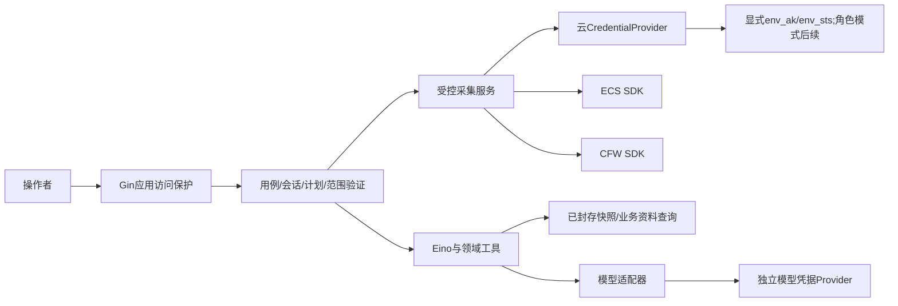

# 凭据、权限与外呼准入设计

基线：需求v0.6／B2、设计v0.6，G1／G2已通过。本文为该领域的现行详细设计；实际运行验收另行取证。

2026-11-17按用户要求统一全部外部配置为显式`--env-file`或同名进程环境，删除分散JSON与实验私配入口；2026-11-18进一步删除累计用量授权与修订机制。连接权限上界与来源限定业务目录分开。以下区分已落地代码、具体接口和仍待真实验证的保证；当前证据与剩余项见[代码记录](../validation/evidence/conversation-implementation-local.md)及[实现台账](../development/implementation-gap.md)。静态Provider、上游未验证和完整M0未验边界保留。

## 1. 四种身份不能混为一个 token

| 层 | 证明／允许什么 | 配置位置与边界 |
| --- | --- | --- |
| 应用访问 | 操作者是否能读本地历史、建任务、确认资料和导出 | 最小本地访问口令／同源控制；不是云密钥，不形成组织账号系统 |
| 云连接身份 | 该连接以哪个 RAM 用户／角色调用哪些云服务 | 服务端 CredentialProvider；CFW 与 ECS 可共享一个明确的凭据来源，但各自权限均需具备 |
| 模型身份 | 已配置模型服务的API访问 | 统一配置的模型字段，显式文件或同名进程环境。凭据来源明确，不借云AccessKey、不自动读dotenv或机器profile |
| 工具执行授权 | 此次会话／任务允许读哪些资产、引用与数据字段 | 服务端专用 ToolRegistry＋范围／任务时限；模型不接收凭据，也不能提升权限 |

MCP 若未来出现，是第五个“连接到工具服务器”的认证边界，不替代云身份、应用身份或工具权限。

## 2. 依赖注入：凭据不经模型传递

启动时组装接口：采集服务持有 CloudClientFactory／CredentialProvider，模型适配器持有 ModelCredentialProvider，Agent 工具仅持有领域 QueryService 与包含 policy_scope_ref 的授权上下文。云 SDK、私有配置和 raw token 不作为工具参数，也不放聊天／系统提示词／可序列化 Eino state。

Gin 的 request context 仅用于本次 API 的认证、验证和短事务。异步任务复制已验证的 operator／workspace／connection／scope 引用和任务时限，由服务根 context＋任务 deadline 驱动；不得保留池化 Gin Context，也不能因返回 202 就把后台工作取消。

## 3. 云平台与云防火墙的统一连接

同一`cloud_connection_id`描述认证来源、账号期望值、受支持API、管理员读取权限上界、配置版本及脱敏就绪状态。它不应承载全量业务资产目录；名称／ID／类型／地域及本次目标由会话意图、资源目录与已接受计划确定。当前allowed_assets／allowed_nat_gateways已作为可选额外收紧条件，来源限定业务目录独立持久化，不能以空名单隐式扫描账号，见[采集设计](aliyun-collector.md)。ECS、CFW、必要 VPC 客户端注入同一明确凭据 Provider，再由各 SDK 为相应服务签名；不要求每个产品在对话里分别输入 AK。

但共享身份不等于共享全部权限：RAM 需要覆盖各产品相应读取动作，应用还要限制该任务真正需要的操作和对象。身份验证成功不代表账号开通了 CFW，也不代表 API 分页／字段／保护范围完整。

### 3.1 最小业务动作映射

以下动作名依据已保存官方资料的授权段落；不是已经下发的 RAM 策略，不自动创建 RAM 用户／角色或授权。资源级限制与条件是否支持以各接口授权页为准，不能从SDK包名猜RAM namespace。名称／标签须先经ECS目录解析，再用稳定身份关联CFW保护视图；CFW的SearchItem不提供名称／标签目录，NAT防火墙目录不代表账号全部NAT网关。当前接口条件与请求量依据见[采集研究](../research/collection-workload.md)。

| 数据 | 只读业务 API | 官方动作／处理 |
| --- | --- | --- |
| CFW 资产 | DescribeAssetList | `yundun-cloudfirewall:DescribeAssetList` |
| CFW 互联网 ACL | DescribeControlPolicy | `yundun-cloudfirewall:DescribeControlPolicy` |
| NAT 网关／防火墙元数据 | DescribeNatFirewallList | `yundun-cloudfirewall:DescribeNatFirewallList`（T-02） |
| NAT 边界 ACL | DescribeNatFirewallControlPolicy | `yundun-cloudfirewall:DescribeNatFirewallControlPolicy`（T-01） |
| 静态引用 | DescribeAddressBook | `yundun-cloudfirewall:DescribeAddressBook` |
| ECS 上下文 | DescribeInstances | `ecs:DescribeInstances` |
| 安全组上下文 | DescribeSecurityGroupAttribute | `ecs:DescribeSecurityGroupAttribute` |
| 必要网卡／EIP | 相应 Describe 查询 | 仅范围确需时添加并按 A-27／A-13 核对授权，不默认整个 VPC 读权限 |
| 当前调用身份 | GetCallerIdentity | 仅明确的连接检查／首次受控采集时核对账号与身份；A-30 暂无授权信息透出，不编造其最小 IAM 条文 |

某些列表查询为完整性需要读取账号相关策略分区；必须在采集前展示这一读取范围。RAM 资源粒度不足时，应用范围和模型投影仍限制用途，但不能反称 RAM 已实现每台资产级隔离。

## 4. CredentialProvider 模式与启动注入

A-28／A-29 提供官方 Go 凭据路线。**本应用默认显式选择连接模式，不无条件采用整台机器的默认凭据链**，不悄悄读 `~/.aliyun`、其他项目或公司环境身份后尝试调用。

| 模式 | 场景 | 自动续期／前提 |
| --- | --- | --- |
| `env_sts`／私有临时配置 | 当前E4已接：统一配置中显式选择同一记录的STS三元组 | 静态Provider；可检查已知到期但不自动续期，过期需重新注入 |
| `env_ak`／私有 RAM AK | 当前E4已接：暂不具备短期凭据条件的明确低权限RAM身份 | 静态Provider；身份核对拒绝root，保护与轮换由操作者负责 |
| `assume_role` | 后续设计，当前配置不接受此模式 | 尚未实现角色取得／续期；未来仍须源身份与sts:AssumeRole授权，不自动提权 |
| `ecs_ram_role` | 后续设计，当前不访问实例元数据 | 尚未实现实例角色Provider；未来仍须显式启用，不把长期AK写镜像 |

默认链是 SDK 提供的能力，不是本应用自动获准使用的身份。若以后允许标准环境变量／配置 profile，也需操作者显式选定并绑定期望账号，不能凭缺少项目配置就回退到其他身份。

当前按显式连接复用静态CredentialProvider，不为工具取得另一身份；尚无远程STS换取／自动续期。客户端缓存与并发续期合并属于后续可续期模式的要求，不能说成已经实现。密钥／token 轮换不应破坏业务历史；新密钥仍需属于相同允许身份，账号／权限边界改变则重新校验并阻止越界任务。

## 5. 统一配置与执行检查

[configuration](../../server/internal/configuration/config.go)是唯一外部配置入口，[模板](../../.env.example)覆盖应用、模型、云、任务保护和数据时效。显式`--env-file`选择字面dotenv；省略时使用同名进程环境。进程存在值（含空）优先于文件，再取默认值；不搜索dotenv、机器profile、实例元数据或旧JSON。

| 配置 | 用途 |
| --- | --- |
| `CFW_APP_TOKEN`／`CFW_DB_PATH`／`CFW_WEB_DIR` | 应用访问、私有数据库、构建目录 |
| `CFW_MODEL_*` | 启用、HTTPS地址、模型／协议、provider profile、密钥、单请求超时和回复长度 |
| `CFW_CLOUD_*`／`CFW_ALIYUN_*` | 显式身份、期望账号、有限地域／边界、可选对象收紧、请求超时与静态凭据到期 |
| `CFW_TASK_TIMEOUT_SECONDS`／`CFW_QUEUE_TIMEOUT_SECONDS` | 全任务执行时限与排队等待；采集、规则、Agent和串行批次共享执行截止时间 |
| `CFW_AGENT_MAX_ROUNDS` | 单任务Agent最大模型轮数，最后一轮不再发起无答案轮的补查 |
| `CFW_FRESHNESS_*` | 配置与元数据最大复用时长；0不复用，还核来源、完整性和关联 |

模型输出token只控制回复长度；本地仅校验正整数，不设置1024等未验证的供应商上限。实际服务是否接受所配长度须由其响应验证。保留用户模型、provider profile及实际私有值，不因本轮清理自动加大输出或发起真实请求。

云凭据整组选择来源：进程任一AK ID／Secret／Token存在，整组取进程，缺项不借文件补齐。模型、云、应用身份独立；密钥和私有端点不进入模型、前端、日志、报告或Git。禁用适配器不读取其密钥；启用但凭据缺失只阻断对应适配器。

文件最大64KiB且须为普通文件；支持export、引号、BOM、CRLF和注释，不执行shell或变量展开、不修改进程环境。未知／废弃字段、重复键、非法类型受控报错且不回显原值。文件相对路径以文件目录为准，进程相对路径以运行目录为准。实际命令见[后端说明](../../server/README.md)。

启动、检查与预览零外呼；config-check不开业务库，账本与上游保持not_checked。configured／enabled／ready只表示本地条件，不证明上游身份、权限或协议已通过。任务接受仍固定配置版本、来源、范围和允许的云／模型效果；发送前核任务活动、取消、截止时间与效果，云身份先核期望账号。connection_check仅IDENTITY_ONLY partial，不代表产品权限通过。

### 5.1 调用记录与任务保护

云与模型共用Manager和`outbound_attempts`记录，每个物理HTTP请求（含身份和有限SDK重试）先保存记录再发送，返回后保存受控状态、耗时、HTTP状态和实际可得token。账本不可写则不发送；缺usage保持未知。记录可以按任务／会话汇总，历史用量不参与后续请求准入。

2026-11-18按用户要求删除应用／会话累计额度、预算名称、授权到期、owner绑定、只能收紧、增额修订和管理员增额命令。任务也没有独立HTTP次数／工具总数／工具单批额度，不用近似无限值替代。任务总时限、Agent轮数、有限重试、取消和响应／输入大小保护负责停止失控执行。云只读、身份隔离、有限查询范围和证据可追溯继续保留。

business schema 6不含累计预算表或预算引用。未上线项目不兼容旧计划／配置：旧库保留原样，选择新私库路径并显式初始化；正常启动不自动迁移或重放调用。配置检查、调用记录、连续任务、重启、取消、凭据隔离及人工HTTP协议使用本地回归验证，真实云／模型与业务验收另行取证。

## 6. 续期、时延与错误

静态 STS 过期时不能声称 SDK 总会自动续期；只有角色等 Provider 有明确可续期来源才成立。取得凭据、身份检查、刷新、API 请求和退避均计入任务总时限，不能只统计 Describe 接口网络耗时。

凭据库的缓存、刷新触发、内部超时／重试及 transport 注入要在固定版本中验证。给 GetCredential 外套一个协程超时并不证明底层调用停止；已发出的请求只能尽力中止，不保证撤回。当前静态Provider不做自动续期；未来明确可续期模式也不增加无限后台刷新，单次过期只允许受控刷新／重试，不重建整个审计来重复执行。

| 类别 | 行为 |
| --- | --- |
| 配置缺失／类型混搭 | 本地返回配置错误，不发外部请求，不要求在聊天贴密钥 |
| 静态 STS 到期 | 说明需操作者更新连接；原历史保留，不自动回长期 AK |
| 可续期角色凭据到期 | 在既定次数／剩余时限内请求 Provider 刷新，失败停止该阶段 |
| AssumeRole／API 被拒绝 | 返回权限类别与受影响阶段，不自动加权限或尝试全局身份 |
| 账号不符／主账号身份 | 拒绝继续业务采集，显示连接别名／错误类别，不在公开记录输出对方账号详情 |
| 限流／服务失败 | 共享限速、有限退避；记录真实尝试和累计时间，不多层重试叠加 |

应用默认接受被明确配置的 RAM 用户／AssumedRole 业务身份；上游角色源也应是低权限 RAM 身份，不能仅以最终角色身份验证就证明上游 AK 没有过高权限。系统不自动创建这些身份，操作者在实际接入时配置并验收。

## 7. MCP 的位置：可选受控连接器，不是认证捷径

首版的专用工具通过本地 QueryService 和官方 SDK 足够，不把外部 MCP 作为必需部署服务。MCP 不天然知道应使用哪个云账号，也不替代 RAM、SDK 签名或工具授权。

若以后确有可信外部 MCP 数据源：

- 只由后端管理员配置固定服务器／传输／工具白名单，默认关闭；模型不能任意输入服务器地址、加载工具或执行命令。
- HTTP 传输按服务器实际支持的授权及 X-01 规范处理 OAuth／资源绑定等，MCP token 只发给对应受众，不将云／模型 token 混传。
- stdio 的进程／环境注入和远程 OAuth 不同；若采用，仅显式允许必要字段，不继承全量环境，不由模型控制启动参数。
- 服务器工具的名单／版本、返回 schema、只读权限、范围、大小与任务时限仍由应用约束；远端声称只读不等于应用验证已通过。
- 云 AK 不因对方是 MCP 就交给第三方；远端如何访问云资源、身份委托与信任边界需单独审核。工具结果仍是外部数据，不能改变系统指令。

这是后续扩展门槛，不是已接入 MCP／已实现 OAuth 或本方案付费请求授权。

## 8. G2 后验收

- 配置检查零外部请求；当前实验配置行为不被未来云 Provider 的急切初始化破坏。
- 模拟同一 RAM Provider 对 CFW／ECS 不同服务签名和白名单；无任意 write／RPC／endpoint 入口。
- 身份不符／静态 STS 过期／续期失败／产品未开通分别处理；不读机器其他 profile 或混搭凭据字段。
- 固定版本 Provider 在并发、过期与总时限中的请求次数／续期／取消行为可观察，不只测外层函数返回快。
- 会话、日志、GORM SQL 日志、错误、报告和 Eino state 不含原始凭据；公开导出不泄露身份细节。
- Gin 请求结束后排队任务仍按服务根 context 执行，取消／停机只终止后续已授权请求，不错误继承 HTTP 生命周期。

本节官方资料核对与当前E4人工HTTPfixture不等真实账号验证。显式云配置、静态Provider、身份先行与固定只读SDK适配已接入；当前切片与待验项见[E4适配记录](../validation/evidence/e4-adapters-local.md)，E3历史证据保持原边界。

## 9. B2 的最小授权与实现约束

- 连接配置提供单账号、allowed_boundaries／允许地域／固定只读动作的权限上界；对象／网关名单若配置仅额外收紧，不要求逐台预列全部资产。业务ResourceCatalog由有来源导入或已接受的有限发现形成，配置scope条目只是“已配置但未验证”。空目录不自动扫描账号，缺资料生成有限发现proposal并沿同一目标接受。
- NAT名称／ID先经有来源目录解析、必要消歧后固定一个获准NatGatewayId；默认不传跨账号 MemberUid，不从可见的其他成员账号推导授权。返回账号／网关归属不符或含义未核实时拒绝相关输入，不切换身份补查。
- 当前只读操作是 DescribeNatFirewallList 和 DescribeNatFirewallControlPolicy；不按猜测的 List／V2 名称推断新旧或回退。曾出现的无可靠依据“已废弃”断言已撤除。T-01～05 的来源与字段见 [云采集设计](aliyun-collector.md)。
- 官方 NAT 动作支持按 ACL 的 AclUuid 和防火墙的 ProxyId 描述资源范围，不能声称只能资源 `*`，也不能把查询参数 NatGatewayId 塞进这两个 ARN 标识。优先账号限定／已知资源范围；为全分区枚举需更宽模式时明确告知并实际验证，不伪称逐网关／资产隔离。禁止全动作 `*`、FullAccess 和任何写操作。
- SNAT／DNAT 首版仅使用已明确提供的关联上下文，默认不新增 VPC 转换表查询；确需增加最小只读补证时，在 G2 列出新 API、RAM、数据与预算后采用。
- 所核 CFW Go SDK 有 WithContext 并调用 CallApiWithCtx。正式适配必须使用任务根 context；公开源码不代表凭据库、ECS、重试或底层网络取消已全部验证。G2 后用模拟 HTTP 和可控凭据源观测实际尝试，不只测外层超时返回。
- 执行计划预览／范围目录／auth-status 均本地读取，不换 STS 或访问云服务。真正外呼只在显式执行且效果上限允许时发生。身份检查与两轮复读共用任务截止时间，范围变化须重新预览。

对应验证：B2-02／09／15～17、AC-09／18。配置检查只做本地解析，不生成或下发RAM策略、不使用机器其他profile，也不自动调用云／模型。

## 10. 统一准入与传输门槛（RV4-04／06／09）

Web Handler 只能提交类型化意图给 ExecutionAdmission，不能直接取得 CloudClient 或 ModelClient。kind 对应效果由服务端定义，/jobs 的调用方不能覆盖计划里的 kind／scope／任务保护。模型生成的建议不是用户确认事件，不能自行进入执行队列。

本地目标／目录规划不持CloudClient；需要发现或刷新时进入客户已接受的类型化准备计划，可在同一audit目标范围内继续，不逐API确认。固定资料助手明确选择模型后只允许模型与本地QueryService，禁止隐式身份检查／STS／云刷新；历史已有解释可零模型读取。连接检查不具模型权限，当前仅身份检查；请求沿用任务时限与有限重试，单个操作成功不等于全部产品权限通过。Provider 必须惰性取得凭据，不能因为组装客户端、读取状态或生成预览而触发续期。

已知的应用／云／模型凭据值不得进入消息、审阅意见的日志或模型投影；自由文本不宣称完全可自动脱敏。审阅意见默认属于本地私有记录，不因保存在同会话就全部发送给模型或导出公开报告。

CFW SDK WithContext 的存在仅是接口依据。E0 必须证明：实际 HTTP 可取消、SDK／凭据内部重试可在同一 attempt ledger 计数、响应在解码前有界、错误正文不会泄露。若固定版本不能提供这些控制点，该适配不能作为通过版本，需要调整适配或回到 G2，不用外层 goroutine 超时或事后截断掩盖缺口。

当前云单次响应2MiB、每分区1000策略等为未校准工程保护值，由输入／计算保护和任务总时限约束，不是厂商限额或已测容量。超限／截断产生 COLLECTION_PARTIAL／UPSTREAM_RESPONSE_TOO_LARGE，不把被截掉的匹配条件当 ANY。具体正常响应可用性在模拟和真实 fixture 中验收，未经确认不自动抬高。

所有请求在物理发送前保存记录，包含身份检查与重试，发送未知时如实保留；与[会话设计的调用记录](session-and-execution.md#104-逐物理请求的调用记录)一致。该设计不创建新 RAM 用户、开通产品、安装客户端或增加云写接口。

## 11. SSE访问保护

按 [前端与事件](frontend-and-events.md) 使用 fetch 响应流，不使用无法携带既定应用访问头的裸 EventSource，也不把口令拼进 URL。事件页、SSE、结果和报告共用应用访问／范围检查，认证必须发生在流式响应头之前；不新增 Cookie 登录、开放 CORS、云权限或模型权限。

401 停止自动重连并要求本地解锁；403／404 停止，不能把权限错误当网络错误持续轮询。连接有最大寿命，应用口令轮换应关闭已有订阅或要求重鉴权。客户端／服务器均不记录授权头，事件只输出公共投影，不含原始错误、凭据或 reasoning。长连接与业务 job context 分离；慢客户端超时、订阅中止均不触发模型／云重试或取消任务。

## 12. 三会话共享准入

单进程提供3任务槽位。物理请求记录在短事务提交后才发送；共享云／凭据并发2、模型并发3，每任务1，等待受任务截止时间限制。各任务的范围、输入和取消独立，历史累计用量不参与准入。

当前只共享显式静态CredentialProvider，按connection／配置版本／期望账号隔离；未来可续期模式复用固定凭据库的并发控制并逐HTTP计数。审计资料首版只复用已提交合格不可变缓存，不实现inflight采集合并；取消一个任务不取消他人，不隐式切机器profile。存储不可写停止新外呼，Swagger文档／UI同应用鉴权、无秘密示例／URL口令，详细门槛见[总体架构](architecture.md)。
